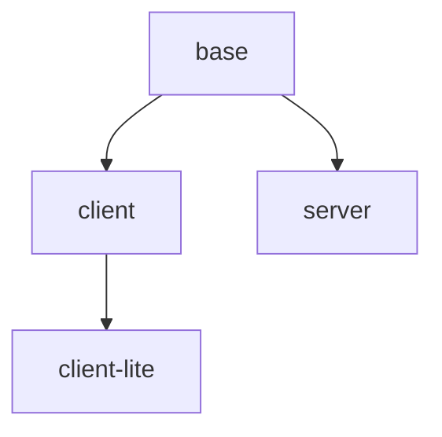

# Repository Layout

The NSUM data model lives in a Git repository: **configuration in `workspace.json`, content in `branches/<branch>/`, per-branch manifests in `branch_config/<branch>.json`**.

## Top-level layout

```text
<repository>/
├─ workspace.json              # Workspace and branch definitions (source of truth)
├─ branch_config/
│  ├─ <branch>.json            # file_manifest / pointer_files /
│  │                           # serverconfig_sync / custom_mods
│  └─ <sha256>.pointer         # Pointer files (content-addressed)
├─ branches/
│  ├─ base/                    # Base content shared by client/server
│  │  ├─ mods/
│  │  ├─ config/
│  │  └─ ...
│  ├─ client/                  # Client-only overrides
│  └─ server/                  # Server-only overrides
└─ .gitignore
```

> The repository stores the recipe, **not** the game or loader; large files are referenced by pointers.

## workspace.json

```json
{
  "version": "1.0",
  "workspace": {
    "name": "My Pack",
    "minecraft": "1.21.1",
    "modloader": "neoforge",
    "modloader_version": "21.1.209"
  },
  "git": {
    "remote": "git@github.com:owner/repo.git",
    "default_branch": "main"
  },
  "branches": [
    { "name": "base", "parent": "", "type": "universal" },
    { "name": "client", "parent": "base", "type": "client" },
    { "name": "server", "parent": "base", "type": "server", "core": "paper" }
  ],
  "sync_policies": {
    "default_folder_policy": "mirror",
    "folders": { "mods": "mirror", "config": "mirror", "logs": "skip" },
    "files": {
      "config/partial.json": { "mode": "partial", "tracked_keys": ["keep"] }
    }
  },
  "export": {
    "metadata": { "name": "My Pack", "version": "1.0.0", "author": "author" }
  }
}
```

| Field | Type | Description |
|---|---|---|
| `workspace.minecraft` | string | Target Minecraft version |
| `workspace.modloader` | string | `fabric`/`quilt`/`forge`/`neoforge` etc. |
| `git.remote` | string | Repository URL (written into `.nsumpack`) |
| `git.default_branch` | string | Default Git branch (recorded on export) |
| `branches[].name` | string | Modpack branch name |
| `branches[].parent` | string/null | Parent branch (inheritance source) |
| `branches[].type` | string | `universal`/`client`/`server` |
| `branches[].core` | string | Server core (server only) |
| `branches[].hidden` | bool | Hidden from selection lists |
| `branches[].modloader_version` | string | Branch-level loader version override |
| `branches[].description` | string | Description |
| `sync_policies` | object | Sync policies (see [Sync rules](./sync-rules.md)) |
| `export.metadata` | object | Default export metadata |

## branch_config/<branch>.json

One file per branch with four sections:

```json
{
  "file_manifest": { "mods/example.jar": "<sha256>" },
  "pointer_files": {
    "<sha256>": { "resolver": "direct_url", "metadata": { "url": "https://..." } }
  },
  "serverconfig_sync": { "enabled": false, "scan_paths": [], "rules": [] },
  "custom_mods": { "enabled": false, "path": "", "merge_order": "post" }
}
```

| Section | Description |
|---|---|
| `file_manifest` | Relative path → SHA-256 (pointer/cache index) |
| `pointer_files` | SHA-256 → resolver and metadata |
| `serverconfig_sync` | L3 save-level config sync |
| `custom_mods` | External mod directory merge |

## Branch inheritance

- Child branches inherit parent files; same-path files in the child override the parent;
- File markers (`delete`/`override`) are stored in the branch manifest;
- Inheritance cycles are rejected; `NeoWorkspaceEditor.exe exec validate` checks this.



## Branch types

| Type | Purpose | Constraint |
|---|---|---|
| `universal` | Shared client + server | — |
| `client` | Client-only | Should not be used on servers |
| `server` | Server-only | bridge refuses to launch it client-side |

## Integrity

```powershell
NeoWorkspaceEditor.exe exec validate --repo <repository>
```

- Errors: duplicate branch names, missing parent, inheritance cycle;
- Warnings: missing `branches/<name>/` or `branch_config/<name>.json` (common in local repos).
