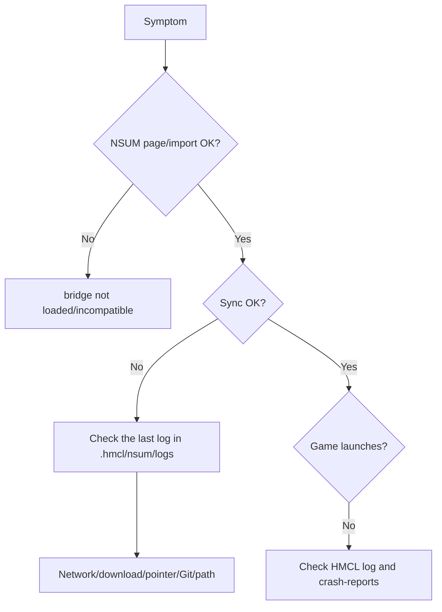

# Troubleshooting

First decide which layer failed: **HMCL/bridge** → **Runtime sync** → **game launch**. Each layer has its own logs.

## Log locations

| Log | Location |
|---|---|
| Runtime build log | `builder.log` in the runtime directory |
| bridge sync log | `<HMCL>/.hmcl/nsum/logs/` |
| HMCL log | HMCL's own log directory |
| Game crash | instance `crash-reports/` |

## Triage tree



## Symptom 1: install stuck at 0 B/s or download failure

**Log keywords**: `download`, `timeout`, `HTTP 502`, `curl`.

Cause: proxies/networks that dislike large parallel downloads; GitHub throttling.

Fix:

1. Retry (parallel failures fall back to a single stream);
2. Download the Runtime zip manually, place it in `.hmcl/nsum/downloads/`, and use "Install from downloads";
3. Check proxy/firewall and that the metadata site is reachable.

## Symptom 2: sync failure (download/pointer)

**Log keywords**: `PointerDownloader`, `resolve_url`, `SHA-256`, `No resolver`.

| Keyword | Cause | Fix |
|---|---|---|
| `No resolver found` | Pointer plugin not loaded/unknown type | Check the `pointers/` plugins and the resolver name |
| `SHA-256 hash mismatch` | Corrupted/tampered download | Delete the cached file and retry |
| `Download failed` | Network/invalid URL | Check the URL and network |

## Symptom 3: branch checkout fails

**Log keywords**: `pathspec ... did not match`, `checkout failed`.

Cause: confusing the Git branch with the modpack branch; missing remote branch.

Fix: re-select the Git branch in the branch dialog; confirm the branch exists.

## Symptom 4: game crashes on launch

1. Confirm the sync succeeded;
2. Check the Java version (HMCL instance settings);
3. Check that game version/loader match the server;
4. Read `crash-reports` and the HMCL log;
5. Remove conflicting client mods.

## Symptom 5: Unicode/non-ASCII path errors

**Log keywords**: `No mapping for the Unicode character`, exit code `-1073740791` (0xC0000409).

Cause: old ANSI argv/path handling bugs.

Fix: update to Runtime ≥ 1.0.3; if it persists, move the repository/instance to an ASCII path and report it.

## Symptom 6: no NSUM page in HMCL

- Confirm `mods/nsum-bridge-*.jar` exists and is enabled;
- Confirm the HMCL version meets bridge requirements;
- Check the HMCL log for bridge load errors (missing FLF API dependencies).

## Symptom 7: bundled Git unavailable

```powershell
.\NeoServerUpdateModpack.exe info git
.\NeoServerUpdateModpack.exe exec git-update
```

If it still fails, check `git_path` in `install.conf`, or install system Git as a fallback.

## Symptom 8: MCLHR projection fails

**Log keywords**: `mclhr`, `mc mods sync`.

- Confirm `<runtime>/tools/mclhr/mclhr.jar` exists;
- Check the command and exit code in the bridge log;
- Depending on configuration it may be skipped without blocking launch.

## FLFHMCL compatibility

> **FLFHMCL docs**: compatibility, launch failures and log diagnostics: [FLFHMCL FAQ](https://github.com/HiBer2007/FLFHMCL/blob/docs/bilingual/docs/en/users/flfhmcl/faq.mdx) and [diagnostics](https://github.com/HiBer2007/FLFHMCL/blob/docs/bilingual/docs/en/users/flfhmcl/diagnostics.mdx).

## Report template

```text
Runtime: <info version output>
HMCL: <version>
bridge: <jar version>
OS: <Windows version / Java version>
Symptom:
Reproduction steps:
Logs: <last log in .hmcl/nsum/logs / builder.log>
```
