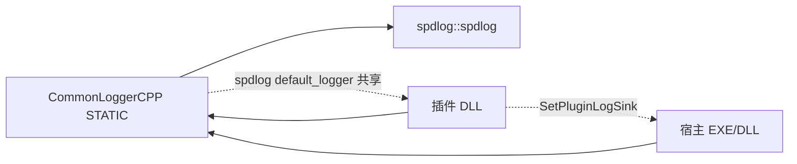

# CommonLoggerCPP 说明

## 概述

`CommonLoggerCPP` 是本仓库统一的日志模块（独立仓库 `CommonLoggerCPP` 的 git submodule，协议 LGPL-2.1）。它把 spdlog 的初始化、sink 组合与「跨模块可见性」问题一次性解决：类名 `CLogger`，**全局命名空间**（没有 `NeoCore::` 之类的包裹），因此任何 target——主程序、编辑器、插件 DLL——都直接调 `CLogger::Info(...)`。

本页说明它的职责边界、依赖、构建集成与可注入的插件日志通道。

## 设计目标

- **零业务依赖**：只依赖 spdlog，可独立构建与复用；
- **单点初始化**：`Init` 幂等，重复调用不抛异常，避免同名 logger 二次注册导致进程异常（历史事故：二次 `register_logger` 抛 `0xE06D7363`）；
- **跨 DLL 可达**：静态库形态下每个插件 DLL 各持一份 `CLogger::instance_`，插件内恒为空——`Resolve()` 回退 spdlog 共享 `default_logger()`，使插件零改动接入宿主日志；
- **插件日志通道可选**：插件导出 `SetPluginLogSink` 就注入宿主 sink（带插件名前缀），不导出则回退 `CLogger`，兼容旧插件；
- **终端可控**：`HoldConsole()` 幂等设置 UTF-8 码页 + VT + 无缓冲二进制流，保证 ANSI 颜色与 UTF-8 中文不被 CRT 改写。

## 模块边界

**做什么**

- 提供 `CLogger`：`Init`/`Get`/`Resolve`/`HoldConsole`/`SetLevel`/`AddSink` 与 `Trace`/`Debug`/`Info`/`Warn`/`Error` 模板方法；
- 组合 stdout 彩色 sink 与文件 sink（`basic_file_sink_mt`，追加）；
- 读 `NSUM_LOG_LEVEL` 环境变量覆盖日志级别；
- 提供插件日志注入契约：`ILogSink`、宿主实现 `LoggerLogSink`、`NEO_DECLARE_PLUGIN_LOG_SINK` 宏。

**不做什么**

- 不做日志轮转/压缩（stdout + 单文件追加即止）；
- 不做业务进度上报（进度看 `NeoCore::IBuildProgress`）；
- 不负责 GUI 日志面板——UI 侧经 `AddSink` 挂自定义 spdlog sink；
- 不管理日志文件生命周期或目录清理。

## 依赖关系

| 依赖 | 类型 | 用途 |
|---|---|---|
| `spdlog::spdlog` | 第三方库（vcpkg，PUBLIC） | logger 实例、sink 实现、级别控制 |
| 使用方（EXE/DLL） | — | 调 `CLogger::*`；插件 DLL 经导出符号接收宿主 sink |

## 文件组成

| 文件 | 作用 |
|---|---|
| `include/logger.h` | `CLogger` 定义与全部内联日志方法 |
| `include/plugin_log_sink.h` | `ILogSink` / `LoggerLogSink` / `NEO_DECLARE_PLUGIN_LOG_SINK` 插件日志约定 |
| `src/logger.cpp` | `instance_`、`Init`、`Resolve`、`HoldConsole`、`SetLevel`、`AddSink` 实现 |
| `CMakeLists.txt` | target 定义、`COMMONLOGGER_BUILD_EXAMPLES` 选项 |
| `examples/main.cpp` | 最小用法示例 |
| `LICENSE` / `vcpkg.json` | LGPL-2.1 许可与独立构建的依赖清单 |

## 构建集成

- target：`CommonLoggerCPP`（`add_library(CommonLoggerCPP STATIC src/logger.cpp ...)`），库类型 **STATIC**；
- 头文件目录：`modules/CommonLoggerCPP/include`，以 `PUBLIC` 暴露；`spdlog::spdlog` 同样 `PUBLIC` 链接，因此依赖方无需再 `find_package(spdlog)`；
- 被 `NeoCore` **PUBLIC** 链接，从而全仓（NeoWorkspace / NeoBuild / NeoCLI / GUIWorker / 主程序 / 编辑器 / 插件）传递获得；
- 自身是静态库，**没有独立部署产物**，日志文件（`builder.log` / `gui.log` / `editor.log` / `core.log`）由各进程在自己的工作目录生成。

## 公共符号概览

| 符号 | 类型 | 说明 |
|---|---|---|
| `CLogger` | class（全局命名空间） | 日志门面，全部接口静态 |
| `CLogger::Level` | enum class | `Trace/Debug/Info/Warn/Error/Off`，数值与 spdlog 等级对齐 |
| `CLogger::Init` | static function | `Init(logFile = "core.log", loggerName = "core")`，幂等 |
| `CLogger::Get` / `Resolve` | static function | 取 logger；`Resolve` 空指针时回退 `spdlog::default_logger()` |
| `CLogger::HoldConsole` | static function | 幂等控制台初始化（UTF-8 码页、VT、无缓冲） |
| `CLogger::SetLevel` / `AddSink` | static function | 运行期改级别、追加 sink |
| `CLogger::Trace/Info/Error/Warn/Debug` | static template | `fmt` 风格格式化输出 |
| `ILogSink` | interface | 插件日志回调：`log(int level, const std::string& message, const char* pluginName)` |
| `LoggerLogSink` | class | 宿主默认实现：转发 `CLogger` 并加 `[插件名]` 前缀 |
| `NEO_DECLARE_PLUGIN_LOG_SINK` | 宏 | 展开出 `SetPluginLogSink` 导出符号与 `PluginLog(level, msg)` |
| `PluginLog` | function（宏产物） | 插件内写日志：有 sink 走富接口，否则回退 `CLogger` |

## 相关文档

- [usage.md](./usage.md)
- [插件契约](../../framework/plugin-contracts.md)
- [扩展与插件注册](../../framework/extension-registry.md)
