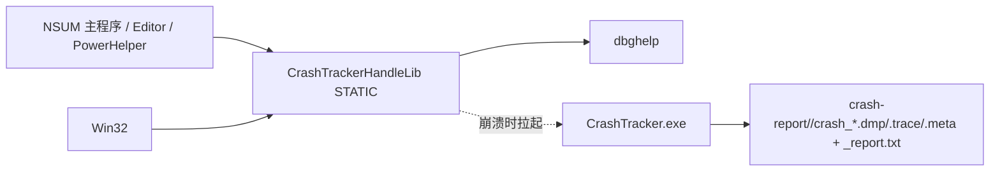

# CrashTrackerHandleLib 说明

## 概述

`CrashTrackerHandleLib`（命名空间 `HiBerCTM`，独立仓库 submodule）是各 EXE 的**进程内崩溃兜底**：装一个未处理异常过滤器，进程崩溃时把 minidump、调用栈、元信息落在 `<exe>/crash-report/<时间戳>/`，然后拉起同目录的 `CrashTracker.exe` 生成可读报告。

它解决的现实问题是：GUI 程序崩溃后用户只会说「闪退了」。有这一层后，崩溃现场有 `.dmp`/`.trace`/`.meta` 三件套可复现、可分析；Debug 构建下连 CRT 堆断言（`HEAP_CORRUPTION` 这类不走 SEH 的错误）也能落盘。

## 设计目标

- **能落盘**：即使堆已被破坏，也要把现场写出去（CRT 钩子路径只用栈缓冲 + Win32 API，禁止一切堆分配）；
- **不挂住进程**：报告写完即 `TerminateProcess`，保留真实异常码，避免 CRT 弹框/abort 卡死；
- **路径不依赖堆**：安装时把 dump 目录预拷到静态缓冲，钩子里只读该缓冲；
- **可选增强**：应用名、帮助文本、崩溃类型解释由宿主通过 `SetCrashAppName` / `SetCrashHelpText` / `AddCrashTypeInfo` 注入，写进 `.meta`；
- **CLI 友好**：`SetCrashCliMode(true)` 时以管道方式跑 `CrashTracker --cli`，输出进宿主终端而不是弹 GUI 窗口。

## 模块边界

**做什么**

- `InstallCrashHandler(dumpDir)`：设定 dump 根目录（空 = 当前 exe 目录）、提升线程栈保证、安装 `SetUnhandledExceptionFilter`；
- 崩溃时写 `crash-report/<YYYYMMDD_HHMMSS>/crash_<ts>.dmp`（`MiniDumpWriteDump`，`MiniDumpNormal`）、`.trace`（调用栈）、`.meta`（应用名/帮助/类型说明）、`crash_signal.txt`（dmp 与 trace 路径）；
- 拉起同目录 `CrashTracker.exe <dmp>`（CLI 模式下 `--cli` + 管道转发输出）；
- `InstallCrtReportHook()`：Debug 构建下挂 `_CrtSetReportHookW2`，捕获 `_CRT_ASSERT` / `_CRT_ERROR` 并写同等三件套后以 `0xC0000374` 结束进程；
- 提供 `SetCrashAppName` / `SetCrashHelpText` / `AddCrashTypeInfo` / `SetCrashCliMode` 四个配置入口。

**不做什么**

- 不做报告解析与展示（那是 `CrashTracker` EXE 的职责）；
- 不做崩溃上报/网络传输、不做符号服务器；
- 不捕获被 `__try/__except` 自行处理的异常；
- Release 构建下 CRT 报告钩子是空实现（`_DEBUG` 才安装），因此 Release 只覆盖 SEH 崩溃。

## 依赖关系

| 依赖 | 类型 | 用途 |
|---|---|---|
| `dbghelp` | 系统库（PUBLIC） | `MiniDumpWriteDump` 写 minidump |
| Win32（`kernel32`/`advapi32` 等，隐式） | 系统 API | `CreateFileA`/`WriteFile`/`CreateProcessA`/`TerminateProcess`/`RtlCaptureContext` |
| `CrashTracker.exe` | 运行时同目录 EXE（非链接依赖） | 崩溃后打开 dump 生成可读报告 |

## 文件组成

| 文件 | 作用 |
|---|---|
| `include/crash_reporter.h` | 公共 API（`HiBerCTM` 命名空间，5 个函数） |
| `src/crash_reporter.cpp` | 异常过滤器、dump/trace/meta 写入、CRT 报告钩子、拉起 CrashTracker |
| `CMakeLists.txt` | `add_library(CrashTrackerHandleLib STATIC src/crash_reporter.cpp)`、`dbghelp` 链接、MSVC 定义 `_WIN32` |
| `examples/main.cpp` | 最小接入示例 |

## 构建集成

- target：`CrashTrackerHandleLib`（**STATIC**），头文件目录 `modules/CrashTrackerHandleLib/include` 以 `PUBLIC` 暴露；`dbghelp` 同样 `PUBLIC`；
- 无独立部署产物（静态库），但**要求 `CrashTracker.exe` 与宿主 EXE 同目录**——根 `neo_deploy` 目标会把 `$<TARGET_FILE:CrashTracker>` 复制进 `deploy/`；
- 使用方：主程序（`PRIVATE ... CrashTrackerHandleLib`）、`NeoWorkspaceEditor`、`PowerHelper` 外壳；
- PowerHelper 独立构建模式会自行 `add_subdirectory(CrashTrackerHandleLib)`（宿主已提供 target 时跳过，避免重复定义）。

## 公共符号概览

| 符号 | 类型 | 说明 |
|---|---|---|
| `HiBerCTM::InstallCrashHandler` | function | `InstallCrashHandler(const std::string& dumpDir = "")`，安装 SEH 过滤器 |
| `HiBerCTM::InstallCrtReportHook` | function | 安装 CRT 报告钩子（仅 `_DEBUG` 生效） |
| `HiBerCTM::SetCrashAppName` | function | 写进 `.meta` 首行的应用名 |
| `HiBerCTM::SetCrashHelpText` | function | `.meta` 中的排查建议文本 |
| `HiBerCTM::AddCrashTypeInfo` | function | 追加「异常码 → 说明」解释块（`===CRASH_DESCRIPTIONS===`） |
| `HiBerCTM::SetCrashCliMode` | function | `true` 时以 `--cli` 跑 CrashTracker 并把输出接到当前控制台 |

## 相关文档

- [usage.md](./usage.md)
- [CrashTracker 说明](../CrashTracker/README.md)
- [测试与崩溃冒烟](../../testing.md)
