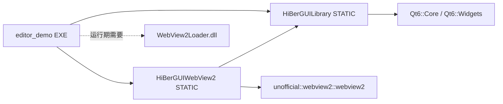

# EditorDemo 说明

## 概述

`EditorDemo` 是 `editor_demo` 这个**演示用 EXE**：把同一个 `ICodeEditor` 接口的两种实现并排放在三个标签页里对比——Qt 版 `CodeEditor`、WebView2 版 `WebCodeEditor`、以及两者的 merge 预览窗口。

它的用途是把「渲染效果、性能、体积（是否引入 WebView2Loader）」摆在一起看，供选型与回归确认；不参与产品发布，`neo_deploy` 也不会复制它。

## 设计目标

- **一屏对比**：同一份 JSON/properties 样例分别喂给两种编辑器，语言/字号/Tab/主题/只读/区域标记都可通过按钮切换；
- **接口一致性验证**：两种实现共用 `ICodeEditor` 与 `builtinLanguages()`，任何一版行为偏差都能直接看出来；
- **工厂机制自证**：演示 `registerCodeEditorFactory(CodeEditorKind::Web, ...)` + `createCodeEditor(kind, parent)` 的接入方式；
- **最小依赖**：只链接 `HiBerGUILibrary`、`HiBerGUIWebView2` 与 Qt6 Core/Widgets。

## 模块边界

**做什么**

- 三个标签页：`Qt 版编辑器`、`WebView2 版编辑器`、`merge 预览对比`；
- 每页的按钮：载入 JSON / 载入 properties、切换深色/浅色、只读/可编辑、语言下拉、Tab 宽度（2/4）；
- 预置区域标记（`{3, 4, "#2f6b31", "tracked"}`）与一个扩展动作（`fmt` 缩进检查）演示 `setRegionHighlights` 与 `addAction`；
- merge 页用 `MergePreviewDialog` 打开 Qt 版与 Web 版对比（黄色=全量覆盖行，绿色=追踪键值对行）；
- `--web` 启动参数：直接切到 WebView2 页，便于诊断运行时缺失。

**不做什么**

- 不做真实业务（样例 JSON/properties/merge 文本都是硬编码常量）；
- 不参与产品发布或 `neo_deploy` 部署；
- 不是测试框架：没有断言与自动化，人工目测；
- 不注册扩展菜单/解析器（那些是编辑器 EXE 的职责）。

## 依赖关系

| 依赖 | 类型 | 用途 |
|---|---|---|
| `HiBerGUILibrary` | STATIC | `CodeEditor`、`MergePreviewDialog`、`ICodeEditor`、`builtinLanguages` |
| `HiBerGUIWebView2` | STATIC | `WebCodeEditor` / `createWebCodeEditor` |
| `Qt6::Core` / `Qt6::Widgets` | Qt | 窗口、标签页、按钮与状态栏 |
| `WebView2Loader.dll` | 运行期 DLL（POST_BUILD 复制） | WebView2 版编辑器的加载器 |

## 文件组成

| 文件 | 作用 |
|---|---|
| `CMakeLists.txt` | `add_executable(editor_demo src/main.cpp)`；链接与运行期部署（`WebView2Loader.dll` + `windeployqt`） |
| `src/main.cpp` | 全部演示代码：`DemoWindow`（三标签页）、样例文本、merge 预览按钮、`--web` 参数 |

## 构建集成

- target：`editor_demo`，**EXE**（`add_executable(editor_demo src/main.cpp)`，未标 `WIN32`，即控制台子系统）；
- include：`src`、`HiBerGUILibrary/include`、`HiBerGUIWebView2/include`（全部 PRIVATE）；
- 链接（PRIVATE）：`HiBerGUILibrary`、`HiBerGUIWebView2`、`Qt6::Core`、`Qt6::Widgets`；
- POST_BUILD（WIN32）：从 `vcpkg_installed/x64-windows[-debug]/bin/` 复制 `WebView2Loader.dll` 到输出目录，并执行 `windeployqt`（`--no-translations --no-opengl-sw --no-compiler-runtime --no-system-d3d-compiler`）；
- 部署：**不在** `neo_deploy` 的 `DEPLOY_DEPS`/复制列表中，产物只留在构建目录（`build/` 下对应的 `editor_demo` 输出目录）。

## 公共符号概览

本 target 是演示 EXE，没有对外头文件。内部可参考的用法点：

| 符号 | 类型 | 说明 |
|---|---|---|
| `DemoWindow` | class（QMainWindow） | 三标签页演示窗口，持有 `qtEditor_`/`webEditor_` |
| `sampleJson` / `sampleProps` / `sampleMerge` | function | 硬编码样例文本（JSON / server.properties / merge 结果） |
| `registerCodeEditorFactory(CodeEditorKind::Web, ...)` | 调用点 | 演示工厂注册（`main` 内） |
| `MergePreviewDialog(CodeEditorKind, parent)` | 调用点 | 演示两版 merge 预览 |

## 相关文档

- [usage.md](./usage.md)
- [HiBerGUILibrary 说明](../HiBerGUILibrary/README.md)
- [编辑器扩展](../../../extensions/editor/index.md)
