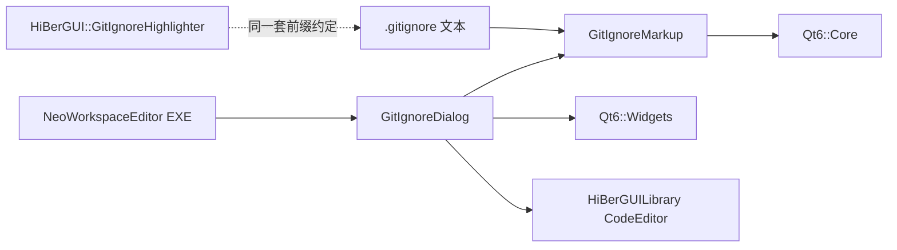

# GitIgnoreMarkup 说明

## 概述

`GitIgnoreMarkup`（独立仓库 `GitignoreMarkup` 的 git submodule，协议 LGPL-2.1）把 `.gitignore` 从「一堆文本行」升级成**可往返（round-trip）的结构化数据**：既能标记某条规则「临时取消但不删除」，也能给规则加「下一行标注」和「组标注」，同时保证浏览器/git 看到的仍是合法 `.gitignore`——所有标记都写成 `#` 注释前缀。

它分两层：纯逻辑 `GitIgnoreMarkup::parseLines/serialize`（只依赖 Qt Core，可供 CLI/其他宿主复用）与编辑对话框 `GitIgnoreMarkup::GitIgnoreDialog`（依赖 Qt Widgets + `HiBerGUILibrary` 的 `CodeEditor`）。

本页解决：标记格式是什么、解析/序列化保证什么、模块边界与构建集成在哪。

## 设计目标

- **标准行仍是标准行**：活动规则就是原样一行，git 行为不变；
- **可逆编辑**：取消勾选不删规则，写 `#! ` 前缀；重新勾选即还原；
- **标注可绑定**：`#> ` 只作用于紧随其下的规则行，`#{ ` / `#}` 成对界定组；
- **纯函数核心**：`parseLines` / `serialize` 无 UI 依赖，便于自动化与 CLI 复用；
- **单一真相**：GUI 列表与代码视图都经同一套解析/序列化，避免两种表示漂移。

## 模块边界

**做什么**

- 解析 `.gitignore` 文本为 `QVector<GitIgnoreMarkup::Line>`（空行丢弃，勾选态置位）；
- 按约定序列化回文本（未勾选规则输出 `#! `，组首尾自动补齐成对，孤立组结束标记丢弃）；
- 提供行类型判定（`isComment`/`isLineLabel`/`isGroupBegin`/`isGroupEnd`/`isDisabledRule`）与便捷构造（`makeRule`/`makeDisabledRule`/`makeLineLabel`/`makeGroupBegin`/`makeGroupEnd`/`makeComment`）；
- `GitIgnoreDialog`：图形化编辑 Tab（勾选/排序/通配符插入/预设/自动总结仓库）+ 直接编辑 Tab（`HiBerGUI::CodeEditor` + `GitIgnoreHighlighter`），保存写回文件并 `emit saved(absPath)`。

**不做什么**

- 不判断某条规则是否真的匹配某个文件（那是 git 的事）；
- 不做 `git add` / 刷新 Git 面板——宿主收到 `saved` 后自行处理；
- 不管理 `.gitignore` 以外的忽略文件（`.git/info/exclude`、全局 excludesFile）；
- 不提供命令行工具；纯逻辑层由宿主自行封装。

## 依赖关系

| 依赖 | 类型 | 用途 |
|---|---|---|
| `Qt6::Core` | Qt（PUBLIC） | `QString` / `QVector` / 解析与序列化 |
| `Qt6::Widgets` | Qt（PRIVATE） | `GitIgnoreDialog` 的对话框部件 |
| `HiBerGUILibrary` | STATIC（PRIVATE） | 直接编辑 Tab 使用 `HiBerGUI::ICodeEditor` / `CodeEditor` |
| `nlohmann_json::nlohmann_json` | 第三方库（工程内 `find_package`） | 独立构建依赖项（对话框工程共用） |

## 文件组成

| 文件 | 作用 |
|---|---|
| `include/gitignore_markup.h` | 纯逻辑层：`LineKind`、`Line`、`parseLines`、`serialize`、判定与构造辅助 |
| `include/gitignore_dialog.h` | `GitIgnoreDialog`（两 Tab：图形化编辑 / 直接编辑） |
| `src/gitignore_markup.cpp` | 解析与序列化实现 |
| `src/gitignore_dialog.cpp` | 对话框实现（列表操作、通配符/预设插入、自动总结、保存） |
| `CMakeLists.txt` | target 定义；独立构建时引入 `HiBerGUILibCPP` submodule |
| `examples/main.cpp` | 最小示例 |
| `LICENSE` | LGPL-2.1 |

## 构建集成

- target：`GitIgnoreMarkup`（`add_library(GitIgnoreMarkup STATIC src/gitignore_markup.cpp src/gitignore_dialog.cpp ...)`），库类型 **STATIC**，无独立部署产物；
- 头文件目录：`modules/GitIgnoreMarkup/include`（`PUBLIC`）；
- 链接关系：`PUBLIC Qt6::Core`、`PRIVATE Qt6::Widgets` 与 `HiBerGUILibrary`——因此**只 include `gitignore_markup.h` 的宿主不会被动依赖 Qt Widgets**，用到 `GitIgnoreDialog` 才需要 Widgets；
- 独立构建时若 `TARGET HiBerGUILibrary` 不存在，会 `add_subdirectory(HiBerGUILibCPP)` 并强制关掉其示例；在根工程内由 `add_subdirectory(modules/HiBerGUILibCPP)` 先行提供 target，故跳过；
- 使用方：`NeoWorkspaceEditor`（`target_link_libraries(... GitIgnoreMarkup ...)`）经「Git → 忽略文件 (.gitignore) → 图形化编辑/直接编辑」打开对话框；
- 示例开关：`GITIGNOREMARKUP_BUILD_EXAMPLES`（默认 ON）。

## 公共符号概览

| 符号 | 类型 | 说明 |
|---|---|---|
| `GitIgnoreMarkup::LineKind` | enum class | `Comment`/`LineLabel`/`GroupBegin`/`GroupEnd`/`DisabledRule`/`Rule` |
| `GitIgnoreMarkup::Line` | struct | `kind`、`prefix`、`text`、`checked` |
| `GitIgnoreMarkup::parseLines` | function | 文本 → `QVector<Line>`（空行丢弃） |
| `GitIgnoreMarkup::serialize` | function | `QVector<Line>` → 文本（`#! ` 表示未勾选，组首尾成对） |
| `isComment` / `isLineLabel` / `isGroupBegin` / `isGroupEnd` / `isDisabledRule` | function | 按 trimmed 行首判定行类型 |
| `makeRule` / `makeDisabledRule` / `makeLineLabel` / `makeGroupBegin` / `makeGroupEnd` / `makeComment` | function | 便捷构造 `Line` |
| `prefixFor` | function | 返回某 `LineKind` 的标准前缀（供高亮/UI 判定） |
| `GitIgnoreMarkup::GitIgnoreDialog` | class（QDialog） | 编辑仓库根 `.gitignore`，signal `saved(const QString& absPath)` |

## 相关文档

- [usage.md](./usage.md)
- [仓库结构与 .gitignore](../../../pack-author/repo-structure.md)
- [编辑器扩展](../../../extensions/editor/index.md)
