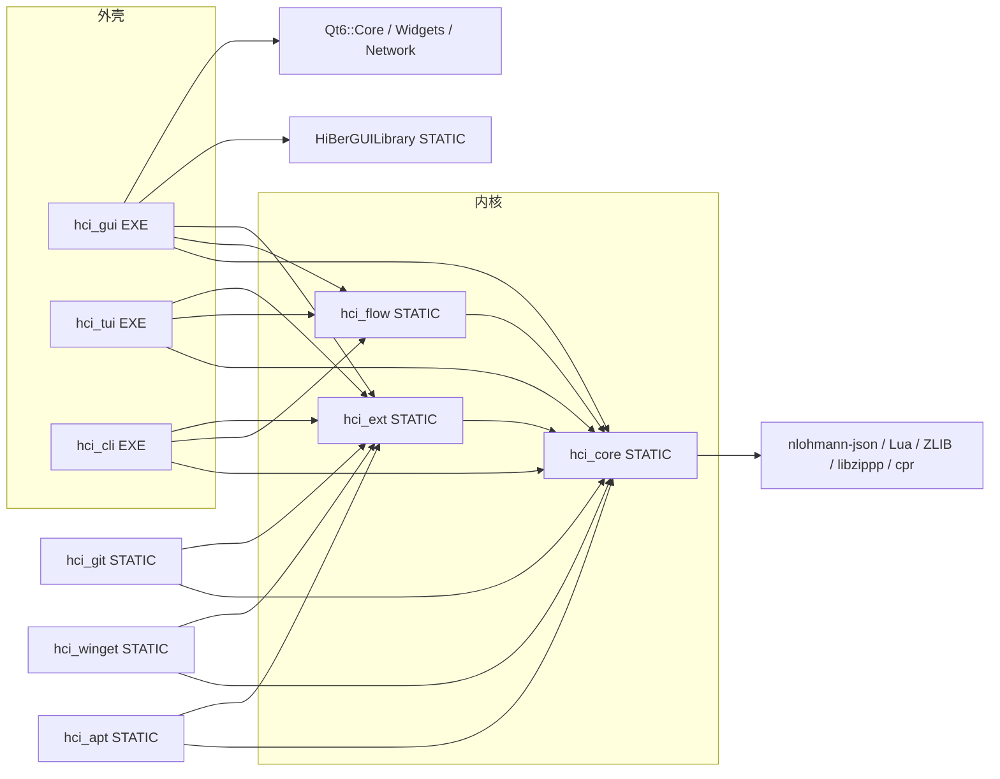

# HiBerCommonInstaller 说明

## 概述

`HiBerCommonInstaller`（缩写 HIC）是本仓库以 git submodule 形式引入的通用安装器框架（`modules/HiBerCommonInstaller`，独立仓库 `HiBerCommonInstaller`）。它把「安装器」拆成与产品无关的内核加产品配置：内核只认识 `product.json`（产品元数据）、flow JSON（声明式流程步骤）以及 payload（要释放的文件），产品差异全部落在配置与拓展里，因此同一套框架既能产出 NSUM 的 `NSUM_Installer_<版本>.exe`，也能被其他产品直接复用。

本页解决一个问题：HIC 由哪些 target 组成、各自边界与依赖是什么、在 NSUM 构建里如何被集成与部署。

## 设计目标

- **内核零 Qt**：`hci_core` 仅依赖 nlohmann-json、Lua、ZLIB、libzippp、cpr，使同一份内核可被 GUI、TUI、CLI 外壳与「安装器即库」模式复用。
- **流程声明化**：安装/卸载/修复/升级四个流程都用 JSON 步骤表达，条件与脚本走内嵌 Lua，改流程不需要改代码。
- **产品无关**：产品名、组件、快捷方式、注册表键、提权策略、payload 规则全部来自 `product.json`；框架内不出现 NSUM 字样。
- **拓展可插拔**：拓展可用静态注册、DLL drop-in、`.hci` 包三种方式加载，用来加步骤类型、CLI 参数与下载后端。
- **可单文件分发**：GUI 外壳支持把 product/flows/deploy 全部经 qrc 内嵌成一个 EXE。

## 模块边界

**做什么**

- 解析产品配置（`ProductConfig`）与流程脚本（`FlowSpec` / `FlowStep`），并按步执行；
- 提供内置步骤：`script`、`clean`、`copy`、`extract`、`download`、`run`、`shortcut`、`template`、`registry`；
- 提供内置 UI 步骤（由外壳渲染）：`language`、`elevate`、`welcome`、`license`、`path`、`git`、`components`、`option`、`confirm`、`input`、`finish`；
- 提供下载后端链（`direct` / `github` / PowerShell / curl）、可插拔后端注册（`winget`、`apt`）、分段多线程下载；
- 提供变量插值（`Vars`）、事件总线（`EventBus`）、服务注册表（`ServiceRegistry`）、日志（`Log` + 多 sink）、提权助手、快捷方式/注册表写入；
- 提供三套外壳 `hci_gui` / `hci_tui` / `hci_cli` 与库模式入口 `hci::entry::runInstall`。

**不做什么**

- 不包含任何 NSUM 专属安装逻辑——NSUM 的 product/flow/payload 与 `--with-editor` 参数拓展都在主仓库 `nsum_installer/` 目录（框架本身保持产品无关）；
- 不负责 Minecraft 整合包的构建、同步与导出（那是 `NeoBuild` / `NeoWorkspace` 的职责）；
- 不提供在线更新服务端，也不决定发行版本号（NSUM 侧由根 `CMakeLists.txt` 的 `NSUM_INSTALLER_VERSION` 单点定义）；
- CLI 文本不做本地化（`hci::lang` 只翻译 GUI/TUI 外壳 chrome，CLI 输出保持英文以便脚本解析）。

## 依赖关系

| 依赖 | 类型 | 用途 |
|---|---|---|
| `hci_core` | STATIC（库，`HCI_CORE_SHARED=ON` 时改共享库） | 变量、上下文、流程无关的 exec/下载/解压/提权/payload/日志 |
| `hci_flow` | STATIC（库） | `FlowSpec` 解析与 `FlowRunner` 执行，依赖 `hci_core` |
| `hci_ext` | STATIC（库） | 拓展宿主：`IHciExtension`、`HostApi`、`ExtensionLoader`，依赖 `hci_core` |
| `hci_git` | STATIC（库） | 通用 Git 策略拓展 `hci.git`（`git_plan` / `git_finalize` / `git_refresh`） |
| `hci_winget` / `hci_apt` | STATIC（库） | 下载后端拓展 `winget`（Windows）/ `apt`（POSIX） |
| `nlohmann_json::nlohmann_json` | 第三方库 | product.json / flow JSON / 事件 payload |
| `${LUA_LIBRARIES}` | 第三方库 | `hci::LuaEngine`（`when` 条件与 `script` 步骤） |
| `ZLIB::ZLIB` / `libzippp::libzippp` | 第三方库 | ZIP 解压（`extract` 步骤、`.hci` 拓展包） |
| `cpr::cpr` | 第三方库 | HTTP 下载（`direct` / `github` 后端） |
| `advapi32` / `shell32` / `ole32` | 系统库（WIN32，PRIVATE） | 注册表写入、快捷方式、UAC 提权 |
| `Qt6::Core` / `Qt6::Widgets` / `Qt6::Network` | Qt（仅 `hci_gui`） | GUI 外壳与 qrc 资源 |
| `HiBerGUILibrary` | STATIC（仅 `hci_gui`） | GUI 外壳使用的通用组件（进度、卡片、编辑器等） |

## 文件组成

| 文件 | 作用 |
|---|---|
| `CMakeLists.txt` | 版本单点（`HCI_VERSION`）、构建选项、`hci_add_version_info`、各子目录装配 |
| `core/include/hci/{vars,context,bus,log,port,exec,payload,product,script,download,download_http,elevation,lang,entry,extension_registry}.h` | 零 Qt 内核公共头 |
| `core/src/script_lua.cpp` | Lua 5.4 脚本引擎（`hci::LuaEngine`） |
| `flow/include/hci/flow.h` | `FlowSpec` / `FlowStep` / `IFlowUi` / `FlowRunner` |
| `flow/src/flow.cpp` | 步骤执行、`when` 求值、UI 步骤派发、外部下载模式 |
| `ext/include/hci/extension.h` | `IHciExtension` / `HostApi` / `HciCapabilities` / `ExtensionLoader` / `HCI_REGISTER_EXTENSION` |
| `ext/src/extension_loader.cpp` | 静态注册、DLL drop-in、`.hci` 包（ZIP + sha256 校验）加载 |
| `ext/git/src/git_ext.cpp` | `hci.git` 拓展：系统/内置/系统安装三种 Git 策略与四布局探测 |
| `ext/winget/src/winget_ext.cpp`、`ext/apt/src/apt_ext.cpp` | 下载后端拓展 |
| `cli/src/main.cpp` | `hci_cli` 外壳：参数解析、`CliUi`、JSON 协议块、外部下载模式 |
| `gui/src/{main,gui_shell,pages,qrc_source,resource_utils}.cpp` | `hci_gui` 外壳：流程页、qrc 资源读取、单文件分发 |
| `tui/src/{main,tui_shell}.cpp` | `hci_tui` 外壳：ANSI 文本界面 |
| `docs/*.md` | 框架自带的 build-guide / core-api / flow-script / product-config / extension-dev / shell-* 说明 |
| `resources/installer.ico` | 外壳 EXE 默认图标（`HCI_ICON_PATH` 可覆盖） |
| `examples/` | 示例产品（`HCI_BUILD_EXAMPLES=ON` 时构建） |
| `HiBerGUILibCPP/` | GUI 外壳使用的 `HiBerGUILibrary` submodule（宿主已提供 target 时跳过） |

## 构建集成

**target 与库类型（`modules/HiBerCommonInstaller/CMakeLists.txt` 与各子目录）**

| target | 类型 | 产物 |
|---|---|---|
| `hci_core` | 库（默认 STATIC；`HCI_CORE_SHARED=ON` 加 `WINDOWS_EXPORT_ALL_SYMBOLS` 并按共享库构建） | `hci_core.lib` / `hci_core.dll` |
| `hci_flow`、`hci_ext`、`hci_git`、`hci_winget`、`hci_apt` | STATIC 库 | 同名 `.lib`，不单独部署 |
| `hci_cli` | EXE（控制台子系统） | `hci_cli.exe` |
| `hci_gui` | EXE（`qt_add_executable`；入口自行保持/释放终端；CMake 注释意图为控制台子系统，但未显式设置 `WIN32_EXECUTABLE`，以实际产物子系统为准） | 默认 `HCInstaller_Template_<HCI_VERSION>.exe`，可用 `HCI_GUI_OUTPUT_NAME` 覆盖 |
| `hci_tui` | EXE（零 Qt） | `hci_tui.exe` |

**构建选项**：`HCI_BUILD_CLI`（默认 ON）、`HCI_BUILD_GUI`（默认 OFF）、`HCI_BUILD_TUI`（默认 OFF）、`HCI_BUILD_EXAMPLES`（默认 ON）、`HCI_CORE_SHARED`（默认 OFF）。

**版本与资源**：`HCI_VERSION` 默认取 `PROJECT_VERSION`，宿主可在 `add_subdirectory` 前覆盖；`hci_add_version_info(<target> <desc> <product>)` 生成 VERSIONINFO（含 `HCI_ICON_PATH` 图标块，MSVC 加 `/utf-8`）。

**NSUM 侧的集成（根 `CMakeLists.txt` 的 `INSTALLER_ONLY_BUILD` 分支）**

1. `NSUM_INSTALLER_VERSION` → `HCI_VERSION` 与 `HCI_GUI_OUTPUT_NAME=NSUM_Installer_${NSUM_INSTALLER_VERSION}`，产物即 `NSUM_Installer_1.0.0.exe`；
2. `configure_file(nsum_installer/product.json @ONLY)` 注入版本后，与四个 flow、`LICENSE.txt` 以及整个 `build/deploy`（跳过 `*.dmp` 与 `config/custom/*`）组成 `HCI_PRODUCT_FILES`，由 `hci_gui` 的 qrc 内嵌；
3. `add_subdirectory(modules/HiBerCommonInstaller)` 后，把 `nsum_installer/ext/nsum_args_ext.cpp`、`ext/git/src/git_ext.cpp`、`ext/winget/src/winget_ext.cpp` 用 `target_sources` **静态注册**进 `hci_gui`（无 `extensions/` 目录、无拓展 DLL）；`hci_cli` 同样并入 git/winget 拓展，否则 flow 会报 `unknown step type: git_plan`；
4. 预设 `installer-static`（`build_nsum_installer`，静态 Qt + `x64-windows-static` + `/MT`）用于产出无运行时 DLL 的单文件安装器；
5. 释放：`hci_gui_release_to_root` 把 `hci_gui.exe` 复制到构建目录根；`hci_cli_dist` 组装 `nsum_cli_dist/`（`hci_cli.exe` + `product.json` + `install_cli.json` 改名 `install.json` + `LICENSE.txt` + `deploy/`）供 bridge 无人值守安装 Runtime。

## 公共符号概览

| 符号 | 类型 | 说明 |
|---|---|---|
| `hci::entry::EntryOptions` | struct | 外壳无关的入口选项（mode/productJson/flow/silent/jsonOut/installPath/language/extensionArgs） |
| `hci::entry::runInstall` | function | 库模式：跑完一个安装流程并返回进程退出码 |
| `hci::entry::renderBanner` | function | 产品名 ASCII banner + 强制 powered-by 行 |
| `hci::ProductConfig` | class | product.json 模型（组件/快捷方式/install.conf/流程/payload/提权/拓展配置） |
| `hci::Vars` | class | 变量表与 `{name}` 递归插值 |
| `hci::InstallContext` | class | 一次运行携带的变量、取消标志、失败策略与自由 state |
| `hci::EventBus` / `hci::ServiceRegistry` | class | 主题发布订阅（同步/排队）与类型擦除服务查找 |
| `hci::FlowSpec` / `hci::FlowStep` | struct | 流程定义与单步骤（id/type/ui/next/when/onFail/params） |
| `hci::IFlowUi` | interface | 外壳 UI 提供者（welcome/license/path/components/git/progress/finish…） |
| `hci::FlowRunner` | class | 执行流程；`setExternalDownload` 开启外部下载模式 |
| `hci::IScriptEngine` / `hci::LuaEngine` | interface / class | 脚本引擎抽象与 Lua 5.4 实现 |
| `hci::Log` / `hci::ILogSink` | class / interface | 多 sink 线程安全日志门面与 sink 接口 |
| `hci::exec::*` | functions | mkdirs/copyTree/cleanDir/extractZip/runProcess/downloadFile/runProcess/快捷方式/注册表 |
| `hci::download::IDownloadBackend` | interface | 可插拔下载后端；`runChain` 按链顺序择优 |
| `hci::IHciExtension` / `hci::HostApi` | interface / class | 拓展接口与宿主 API（bus/services/context/product/registry/log） |
| `hci::ExtensionRegistry` | class | 步骤类型、CLI 参数、下载后端三个注册表 |
| `hci::ExtensionLoader` | class | `loadStatic` / `loadDirectory` 两种加载路径 |
| `HCI_REGISTER_EXTENSION` | 宏 | 链接期静态注册拓展 |

## 相关文档

- [usage.md](./usage.md)
- [ADR 0004 · HIC 声明式安装流程](../../adr/0004-hic-flow.md)
- [安装器（HIC）总览](../../../extensions/installer/index.md)
- [安装器 CLI](../../../extensions/installer/cli.md)
- [外部下载模式](../../../extensions/installer/external-download.md)
