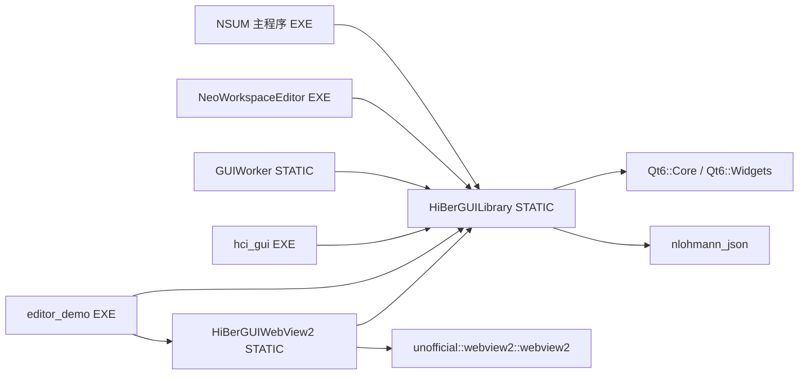

# HiBerGUILibrary 说明

## 概述

`HiBerGUILibrary` 是仓库自研的通用 GUI 组件库（`modules/HiBerGUILibCPP` 工程的主 target，命名空间 `HiBerGUI`，协议 LGPL-2.1）。它只放**与业务无关**的界面部件：进度条与卡片堆、托盘式通知、输出/仓库树面板、代码编辑器套件、merge 预览窗、Git 面板。主程序向导、仓库编辑器、安装器 GUI 外壳都从这里取组件，因此改一个组件会在多处生效——本页说明它的边界与耦合点。

同工程的 `HiBerGUIWebView2` 是「任何依赖 WebView2 的 GUI 组件库」：目前只有 `WebCodeEditor`（实现同一个 `ICodeEditor` 接口）。只有链接它才引入 WebView2 依赖，只用 `HiBerGUILibrary` 的程序零 WebView2 依赖。

## 设计目标

- **组件与业务解耦**：组件不认识 workspace/整合包概念，数据经 setter 与 Qt signal 进出；
- **零 WebView2 基线**：基础库只依赖 Qt Core/Widgets + nlohmann-json；
- **主题自适应**：深/浅色调色板随 `palette()` 与 `ThemeChange` 事件重刷样式；
- **可嵌入**：面板类都是普通 `QWidget`，作为子控件放进任意宿主布局；
- **接口化编辑器**：`ICodeEditor` 抽象让 Qt 版与 WebView2 版可互换，宿主按需注册工厂。

## 模块边界

**做什么**

- 进度与反馈：`AnimatedProgress`、`ProgressCard`、`WorkCard`、`WorkCardStack`、`ToastNotification`；
- 树与面板：`RepoTreePanel`、`OutputTreePanel`、`DeepTreeBehavior`；
- 代码编辑：`CodeEditor`（Qt 版）、`ICodeEditor` / `ICodeHighlighter` 扩展点、`GitIgnoreHighlighter`、`FileContentEditor`、`MergePreviewDialog`；
- Git 界面：`GitPanel`（状态/暂存/历史/提交/推送，全异步）。

**不做什么**

- 不含业务规则（分支继承、同步策略、导出格式判定都在 NeoWorkspace/NeoBuild/GUIWorker）；
- 不做文件落盘与 git 语义——`GitPanel` 只是 `QProcess` 调 git 并展示结果；
- 不依赖 WebView2（那是 `HiBerGUIWebView2` 的事）；
- 不提供主窗口/向导流程（`GUIWorker` 与各 EXE 负责）。

## 依赖关系

| 依赖 | 类型 | 用途 |
|---|---|---|
| `Qt6::Core` / `Qt6::Widgets` | Qt（PUBLIC） | 全部组件基类、绘制、动画、QProcess |
| `nlohmann_json::nlohmann_json` | 第三方库（PUBLIC） | `OutputTreePanel` 接收 JSON 树条目 |
| `unofficial::webview2::webview2` | 第三方库（仅 `HiBerGUIWebView2`，PRIVATE） | 网页版编辑器宿主 |
| `HiBerGUILibrary` | STATIC（`HiBerGUIWebView2` 的 PRIVATE 依赖） | 复用 `ICodeEditor` 接口与语言定义 |

## 文件组成

| 文件 | 作用 |
|---|---|
| `HiBerGUILibrary/include/animated_progress.h` | 平滑/不确定态进度条，`setCompact` 细条常驻模式 |
| `HiBerGUILibrary/include/toast_notification.h` | 右上角错误通知，悬停暂停倒计时 |
| `HiBerGUILibrary/include/progress_card.h` | 仓库加载大卡片（标题/进度/取消） |
| `HiBerGUILibrary/include/work_card.h`、`work_card_stack.h` | 紧凑任务卡与层叠卡片堆（自锚定宿主右上角） |
| `HiBerGUILibrary/include/repo_tree_panel.h` | 仓库树：继承文件、delete/override 标记、指针分组、拖放/剪贴板 |
| `HiBerGUILibrary/include/output_tree_panel.h` | 输出树：U/M/D 条目、格式下拉、配置标记、拖放落点高亮 |
| `HiBerGUILibrary/include/deep_tree_behavior.h` | 树展开/折叠行为：三角/双击，展开一层、深折叠 |
| `HiBerGUILibrary/include/code_editor_interface.h` | `ICodeEditor`、`ICodeHighlighter`、语言定义、区域标记、工厂注册 |
| `HiBerGUILibrary/include/code_editor.h` | Qt 版编辑器（行号栏 + 高亮 + 工具条动作） |
| `HiBerGUILibrary/include/gitignore_highlighter.h` | `.gitignore` 标记语法高亮驱动 |
| `HiBerGUILibrary/include/file_content_editor.h` | 文件内容编辑 + 保存信号 |
| `HiBerGUILibrary/include/merge_preview_dialog.h` | merge 结果预览窗（Qt/Web 编辑器可选） |
| `HiBerGUILibrary/include/git_panel.h` | Git 面板：分支状态、暂存区、历史、提交/推送/拉取（异步） |
| `HiBerGUIWebView2/include/web_code_editor.h` | `WebCodeEditor`：同一 `ICodeEditor` 的 WebView2 实现 + 缺运行时占位 |
| `examples/` | 组件示例（`HIBERGUI_BUILD_EXAMPLES`） |

## 构建集成

- 工程：`modules/HiBerGUILibCPP/CMakeLists.txt`（`project(HiBerGUILibCPP)`，`CMAKE_AUTOMOC ON`，自包含 `HiBerGUILibCPP/HiBerGUILibCPP` 与 `HiBerGUILibCPP/HiBerGUIWebView2` 两个子目录）；
- target 与库类型：`HiBerGUILibrary` 与 `HiBerGUIWebView2` **都是 STATIC**，无可执行产物、无部署步骤；
- 头文件目录：`HiBerGUILibrary/include` 以 `PUBLIC` 暴露；`HiBerGUIWebView2` 额外 `PUBLIC` 转发基础库 include；
- 依赖获取：工程内 `find_package(Qt6 COMPONENTS Core Widgets)`、`find_package(nlohmann_json CONFIG)`、`find_package(unofficial-webview2 CONFIG)`；
- 在根 `CMakeLists.txt` 中 `add_subdirectory(modules/HiBerGUILibCPP)`，被 `GUIWorker`（PUBLIC）、主程序、`NeoWorkspaceEditor`、`hci_gui`、`editor_demo` 链接；
- `editor_demo` 额外把 `WebView2Loader.dll` 与 `windeployqt` 产物复制到自身输出目录（演示用，非正式发布链路）。

## 公共符号概览

| 符号 | 类型 | 说明 |
|---|---|---|
| `HiBerGUI::AnimatedProgress` | class | 进度条：`setValue`/`setIndeterminate`/`setText`/`setCompact`/`startAnimation`/`stopAnimation` |
| `HiBerGUI::ToastNotification` | class | `showError(title, detail, timeoutMs)`/`dismiss`/`setTopOffset` |
| `HiBerGUI::ProgressCard` | class | `showCard`/`setProgress`/`complete`/`fail`/`hideCard`/`isActive`，signal `cancelRequested` |
| `HiBerGUI::WorkCard` / `WorkCardStack` | class | 紧凑任务卡与卡片堆（`addCard`/`removeCard`/`updateLayout`/`reposition`） |
| `HiBerGUI::RepoObjectType` / `RepoObjectInfo` | enum / struct | 仓库节点类型（Root/Folder/ConfigFile/PlainFile/Pointer）与节点信息 |
| `HiBerGUI::RepoTreePanel` | class | `setRootPath`/`setPointerDir`/`setInheritedFiles`/`setBranchManifest`/`setPointerFiles`，多个 `*Requested` 信号 |
| `HiBerGUI::OutputTreePanel` | class | `loadEntries(entries, pointerRels)`/`setExtraConfigFiles`/`setFormat`，`formatChanged`/`deleteRequested` 等信号 |
| `HiBerGUI::DeepTreeBehavior` | class | 附加到 `QTreeWidget` 的展开/折叠行为（`toggleItem`） |
| `HiBerGUI::ICodeEditor` | interface | 编辑器抽象：语言/文本/只读/行号/字号/Tab/主题/区域标记/动作 |
| `HiBerGUI::ICodeHighlighter` | interface | 外部高亮驱动（`highlight(langId, text, spans)`） |
| `HiBerGUI::CodeEditor` | class | Qt 版编辑器实现，signal `languageChanged` |
| `HiBerGUI::GitIgnoreHighlighter` | class | `.gitignore` 标记高亮 |
| `HiBerGUI::FileContentEditor` | class | `loadContent(relPath, absPath, inherited, sourceAbs)` + signal `contentSaveRequested` |
| `HiBerGUI::MergePreviewDialog` | class | `setContent(content, info, langId, highlights)` |
| `HiBerGUI::GitPanel` | class | `setRepoPath`/`setGitPath`/`refresh`/`softResetTo`/`squashDialog`，`gitOperationFinished` 等信号 |
| `HiBerGUI::WebCodeEditor` | class | `ICodeEditor` 的 WebView2 实现（`usingWebView()` 判定就绪） |
| `HiBerGUI::registerCodeEditorFactory` / `createCodeEditor` | function | 按 `CodeEditorKind`（Qt/Web）注册与创建编辑器 |

## 相关文档

- [usage.md](./usage.md)
- [总体架构](../../architecture/overview.md)
- [编辑器扩展](../../../extensions/editor/index.md)
