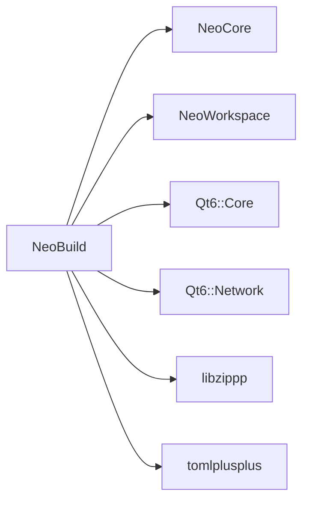

# NeoBuild 说明

## 概述

`NeoBuild`（STATIC）是构建核心：把仓库构建为输出目录，加载导出/指针插件，处理指针下载、serverconfig 与同步策略。GUI/CLI/编辑器都通过它构建。

## 设计目标

- 构建流程可复现（commit + 配置决定输出）；
- 插件化导出与下载方式；
- 取消/进度贯穿整个流程。

## 模块边界

**做什么**

- `BuildEngine`：init/build/preview；
- `BranchMerger`：父链合并；
- `PointerDownloader`：指针解析/下载/缓存；
- `ModpackExporter`：扫描/加载导出器；
- `ServerConfigSync`：L3；
- `SyncPolicyExecutor`：策略应用；
- `ModMetadata`/`UMDGenerator`/`PlatformApi`：元数据与平台适配。

**不做什么**

- 不负责 UI；
- 不实现 plugin ABI（依赖 NeoCore）；
- 不直接写 Git 历史。

## 依赖关系

## 文件组成

| 文件 | 作用 |
|---|---|
| `include/build_engine.h` | `BuildEngine` |
| `include/branch_merger.h` | `BranchMerger`、`MergeResult` |
| `include/pointer_downloader.h` | `PointerDownloader`、`ResolveResult` |
| `include/modpack_exporter.h` | `ModpackExporter` |
| `include/serverconfig_sync.h` | `ServerConfigSync` |
| `include/sync_policy_executor.h` | `SyncPolicyExecutor` |
| `src/*` | 实现 |

## 构建集成

- target：`NeoBuild`（STATIC）；
- 依赖 NeoCore/NeoWorkspace/Qt6::Core/Qt6::Network/libzippp（私有 tomlplusplus）；
- 被 NeoCLI/GUIWorker/NeoWorkspaceEditor 依赖。

## 公共符号概览

| 符号 | 类型 | 说明 |
|---|---|---|
| `BuildEngine` | class | 构建入口 |
| `BranchMerger` | class | 分支合并 |
| `PointerDownloader` | class | 指针下载 |
| `ModpackExporter` | class | 导出器管理 |
| `ServerConfigSync` | class | L3 同步 |
| `SyncPolicyExecutor` | class | 策略执行 |
| `BuildResult` | struct | 构建结果 |

## 相关

- [usage.md](./usage.md)
- [构建流水线](../../architecture/build-pipeline.md)
