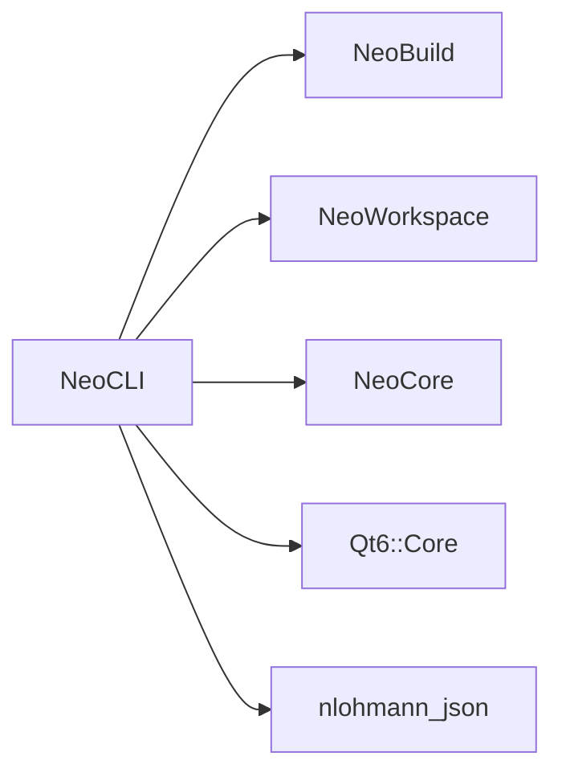

# NeoCLI 说明

## 概述

`NeoCLI`（STATIC）实现主程序的 `info` / `exec` / `flow` 三类命令：解析参数、调用 BuildEngine/Workspace、输出人类日志或 JSON 协议块。

## 设计目标

- 无 GUI 也能完成全部构建/查询；
- 机器可读（`--json`）；
- 与 GUI 共用同一引擎（避免行为分叉）。

## 模块边界

**做什么**

- `ArgParser`：子命令与选项；
- `CliDispatcher`：分发 `info/exec/flow`，实现构建/导出/同步等；
- `CliOutput`：JSON 块与人类日志（日志走 stderr）。

**不做什么**

- 不实现构建逻辑（NeoBuild）；
- 不实现 GUI 页面（flow gui 复用 GUIWorker）。

## 依赖关系

## 文件组成

| 文件 | 作用 |
|---|---|
| `include/arg_parser.h` | `ArgParser`、`CliCommand` |
| `include/cli_dispatcher.h` | `CliDispatcher` |
| `include/cli_output.h` | `CliOutput` |
| `src/cli_dispatcher.cpp` | 命令实现 |
| `src/arg_parser.cpp` | 解析 |
| `src/cli_output.cpp` | 输出 |

## 构建集成

- target：`NeoCLI`（STATIC），链接进主程序；
- 依赖 NeoCore/NeoWorkspace/NeoBuild；
- flow gui 额外链接 GUIWorker。

## 公共符号概览

| 符号 | 类型 | 说明 |
|---|---|---|
| `ArgParser` | class | 参数解析 |
| `CliCommand` | struct | 命令与选项 |
| `CliDispatcher` | class | 命令分发 |
| `CliOutput` | class | 输出 |

## 相关

- [usage.md](./usage.md)
- [CLI 参考](../../../user/cli.md)
