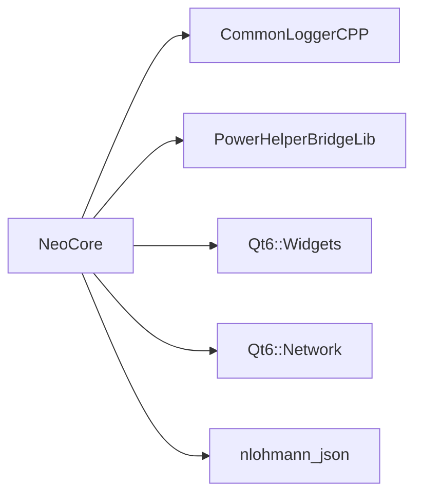

# NeoCore 说明

## 概述

`NeoCore` 是 NSUM 的基础库（STATIC），只包含接口与跨模块工具：插件接口、插件加载、UTF-8 路径、取消令牌、错误码、构建进度与并行下载器。所有引擎、CLI、GUI 和插件都依赖它。

## 设计目标

- 提供稳定的扩展接口，让 parser/pointer/exporter 插件不依赖引擎；
- 统一 Windows 路径与编码处理；
- 提供可复用的下载与取消基础设施。

## 模块边界

**做什么**

- 定义 `IConfigParser`、`IPluginPointer`、`IModpackExporter`、编辑器扩展接口；
- `PluginLoader` 扫描/加载 parser DLL；
- `path_utf8.h`（`fsu8`）、`CancelToken`、`error_codes`、`IBuildProgress`；
- `ParallelDownloader`（Qt 事件循环内 Range 分片）。

**不做什么**

- 不实现构建/同步/导出业务；
- 不依赖 Qt Widgets 之外的 GUI 逻辑（链接了 Qt6::Widgets 以支持编辑器扩展接口）；
- 不持有全局配置。

## 依赖关系

## 文件组成

| 文件 | 作用 |
|---|---|
| `include/IConfigParser.h` | 配置解析接口与能力结构 |
| `include/IPluginPointer.h` | 指针解析接口 |
| `include/IModpackExporter.h` | 导出接口、`BuildTarget`、`ExportMetadata` |
| `include/IConfigEditorExtension.h` / `IPointerEditorExtension.h` | 编辑器扩展接口 |
| `include/PluginLoader.h` | parser 插件加载 |
| `include/parallel_downloader.h` | 并行下载器 |
| `include/path_utf8.h` | UTF-8 路径工具 |
| `include/cancel_token.h` | 取消令牌 |
| `include/error_codes.h` | 错误码 |
| `src/plugin_loader.cpp` 等 | 实现 |

## 构建集成

- target：`NeoCore`（STATIC）；
- 被 NeoWorkspace/NeoBuild/NeoCLI/GUIWorker/插件 PUBLIC 依赖；
- 头文件目录：`modules/NeoCore/include`。

## 公共符号概览

| 符号 | 类型 | 说明 |
|---|---|---|
| `IConfigParser` | interface | 配置解析/合并 |
| `IPluginPointer` | interface | 指针解析 |
| `IModpackExporter` | interface | 导出 |
| `PluginLoader` | class | 扫描/查找解析器 |
| `CancelToken` | class | 取消 |
| `ParallelDownloader` | class | Range 并行下载 |
| `fsu8` | namespace | UTF-8 路径 |

## 相关

- [usage.md](./usage.md)
- [插件契约](../../framework/plugin-contracts.md)
