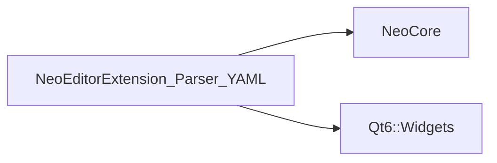

# NeoEditorExtension_Parser_YAML 说明

## 概述

`NeoEditorExtension_Parser_YAML` 是编辑器扩展（SHARED），实现 `NeoCore::IConfigEditorExtension`，为 `.yml` `.yaml` 配置 提供编辑界面/校验。

## 设计目标

- 让作者在 GUI 中安全编辑，不用手写 JSON；
- 与运行时插件配对（运行时负责合并/解析）；
- 只依赖编辑器接口，不依赖主程序。

## 模块边界

**做什么**：创建编辑控件、解析/序列化、校验输入。
**不做什么**：不做同步/下载（运行时插件负责）。

## 依赖关系

## 文件组成

| 文件 | 作用 |
|---|---|
| `src/` | 接口实现与 `CreateConfigEditor` 工厂 |
| `NeoEditorExtension_Parser_YAML.meta.json` | 能力声明 |
| `CMakeLists.txt` | SHARED target |

## 构建集成

- target：`NeoEditorExtension_Parser_YAML`（SHARED）；
- 产物复制到 `editor/extension/parsers/`；
- 编辑器启动时扫描注册。

## 公共符号

| 符号 | 说明 |
|---|---|
| `CreateConfigEditor` | 工厂（`__declspec(dllexport)`） |
| `IConfigEditorExtension` 实现 | capability/createEditor/... |

## 相关

- [usage.md](./usage.md)
- [编辑器扩展](../../../extensions/editor/index.md)