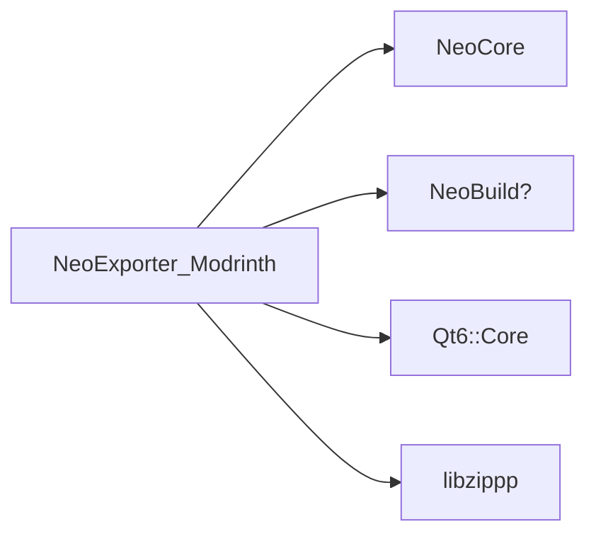

# NeoExporter_Modrinth 说明

## 概述

`NeoExporter_Modrinth` 是导出器插件（SHARED），实现 `NeoCore::IModpackExporter`，把构建产物导出为 modrinth（.mrpack）。

## 设计目标

- 格式可插拔，GUI/CLI 通过 meta 自动生成表单；
- 导出器内包含构建入口（`build_modpack`），保证与格式一致的构建；
- 不依赖 UI。

## 模块边界

**做什么**：声明格式/扩展名/字段、构建并导出。
**不做什么**：不负责同步策略/实例标记（引擎负责）。

## 依赖关系

> 导出器以接口 + 头文件独立编译，构建逻辑由插件内实现。

## 文件组成

| 文件 | 作用 |
|---|---|
| `src/exporter_*.cpp` | 接口实现与 `CreateExporter` |
| `NeoExporter_Modrinth.meta.json` | 格式/扩展名/字段 |
| `CMakeLists.txt` | SHARED target |

## 构建集成

- target：`NeoExporter_Modrinth`（SHARED）；
- 产物复制到 `exporters/`；
- 导出 `CreateExporter`。

## 公共符号

| 符号 | 说明 |
|---|---|
| `CreateExporter` | 工厂（`__declspec(dllexport)`） |
| `IModpackExporter` 实现 | format/extension/build_modpack/export_modpack |

## 相关

- [usage.md](./usage.md)
- [导出器文档](../../../extensions/exporters/index.md)