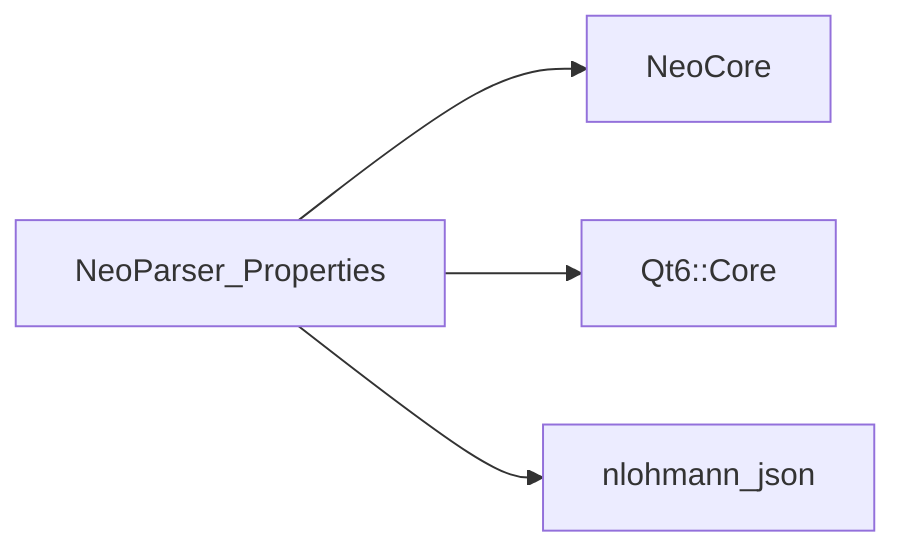

# NeoParser_Properties 说明

## 概述

`NeoParser_Properties` 是运行时配置解析器插件（SHARED），实现 `NeoCore::IConfigParser`，处理 Properties 配置的键级合并。

## 设计目标

- 按 `tracked_keys` 合并，保留玩家本地设置；
- 与编辑器扩展配对（编辑器侧提供语法高亮/键列表）；
- 仅依赖 `NeoCore` 接口，不链接引擎。

## 模块边界

**做什么**：解析配置、按键合并、列出键。
**不做什么**：不做文件同步、网络、UI。

## 依赖关系

## 文件组成

| 文件 | 作用 |
|---|---|
| `src/` | 接口实现与 `CreateParser` 工厂 |
| `NeoParser_Properties.meta.json` | 能力声明 |
| `CMakeLists.txt` | SHARED target |

## 构建集成

- target：`NeoParser_Properties`（SHARED）；
- 产物复制到 `parsers/`（DLL + meta）；
- 导出 `CreateParser`。

## 公共符号概览

| 符号 | 说明 |
|---|---|
| `CreateParser` | 工厂（`__declspec(dllexport)`） |
| `IConfigParser` 实现 | capability/can_handle/parse/merge/list_keys |

## 相关

- [usage.md](./usage.md)
- [解析器文档](../../../extensions/parsers/index.md)