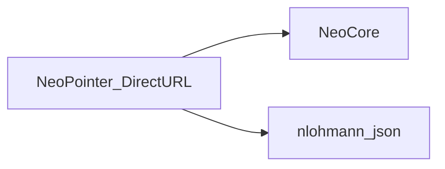

# NeoPointer_DirectURL 说明

## 概述

`NeoPointer_DirectURL` 是运行时指针解析器插件（SHARED），实现 `NeoCore::IPluginPointer`，按指针 metadata 中的 URL 直接下载。

## 设计目标

- 把指针 metadata 解析为下载地址；
- 与编辑器扩展配对，避免手写 JSON；
- 仅依赖 `NeoCore` 接口。

## 模块边界

**做什么**：判断是否可处理、解析 URL、校验下载结果。
**不做什么**：不做缓存管理（PointerDownloader 负责）、不做 UI。

## 依赖关系

## 文件组成

| 文件 | 作用 |
|---|---|
| `src/` | 接口实现与 `CreatePointer` 工厂 |
| `NeoPointer_DirectURL.meta.json` | 能力声明 |
| `CMakeLists.txt` | SHARED target |

## 构建集成

- target：`NeoPointer_DirectURL`（SHARED）；
- 产物复制到 `pointers/`；
- 导出 `CreatePointer`。

## 公共符号

| 符号 | 说明 |
|---|---|
| `CreatePointer` | 工厂（`__declspec(dllexport)`） |
| `IPluginPointer` 实现 | name/can_handle/resolve_url/validate |

## 相关

- [usage.md](./usage.md)
- [指针解析器](../../../extensions/pointers/index.md)