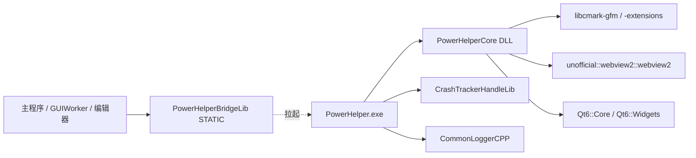

# PowerHelper 说明

## 概述

`PowerHelper`（独立仓库 `PowerHelper` 的 git submodule，协议 LGPL-2.1）是文档阅读器：把 Markdown 渲染成 HTML（WebView2）或 `QTextDocument`（Qt 回退），带目录（TOC）与同目录 `.md` 互跳，并能在终端渲染 ANSI 版本。同一工程产出三件东西：

1. `PowerHelperCore` —— 阅读器核心（渲染器 + 可嵌入视图 + 文档组扫描）；
2. `PowerHelperBridgeLib` —— 集成依赖库（`PowerHelper::Bridge`），让宿主定位并拉起外壳 EXE；
3. `PowerHelper` —— 外壳 EXE（GUI 阅读器 + `render`/`toc`/`group` CLI）。

NSUM 主程序、仓库编辑器与 GUIWorker 通过 `PowerHelperBridgeLib` 提供「打开帮助文档」入口，经 `NeoCore` 的 PUBLIC 链接链传递进来。

## 设计目标

- **真实 HTML 渲染**：表格、图片、相对链接用 WebView2 渲染，避免 `QTextBrowser` 的表格/排版短板；
- **缺运行时不崩**：检测不到 WebView2 运行时（或初始化失败）自动回退 Qt 渲染路径，功能降级但可用；
- **渲染可复用**：同一份 Markdown 同时提供 HTML / `QTextDocument` / ANSI 终端三种输出；
- **宿主解耦**：宿主只依赖 `PowerHelperBridgeLib`（不链核心、不链 WebView2），拉起独立 EXE 打开文档；
- **可 CLI 化**：`render` / `toc` / `group` 子命令输出文本或 JSON，供脚本与 AI 读取文档结构。

## 模块边界

**做什么**

- 渲染：`renderToHtml`、`renderToDocument`、`renderToTerminal`、`extractToc`、`displayWidth`、`expandTabs`、`anchorName`；
- 视图：`MarkdownViewer`（可嵌入 widget，WebView2 + Qt 回退，TOC 跳转、相对链接信号）；
- 文档组：`scanDocGroup(dir)` 递归扫描 `.md` 并填充标题与 TOC；
- 桥接：`findPowerHelperExe`、`launchReader`、`defaultDocsDir`、`classifyTarget`；
- 外壳：GUI 阅读窗口（目录树 + 视图 + anchor 跳转）、CLI 三个子命令、崩溃处理与日志接入。

**不做什么**

- 不做 Markdown 编辑（只读阅读器）；
- 不做站点生成/发布（`tools/build_docs.ps1` 是另一条链路）；
- 不做全文搜索索引、不做 PDF/Office 转换；
- 不把 WebView2 依赖引入宿主——只有外壳 EXE 与链接 `PowerHelperCore` 的程序才需要它。

## 依赖关系

| 依赖 | 类型 | 用途 |
|---|---|---|
| `Qt6::Core` / `Qt6::Widgets` | Qt（PUBLIC） | 渲染到 `QTextDocument`、视图 widget、外壳窗口 |
| `libcmark-gfm` / `libcmark-gfm-extensions` | 第三方库（PUBLIC，`PowerHelperCore`） | CommonMark + GFM（表格、删除线、自动链接、任务列表）解析 |
| `unofficial::webview2::webview2` | 第三方库（PUBLIC，WIN32） | HTML 渲染宿主 |
| `spdlog`（经 `CommonLoggerCPP`） | 第三方库 | 外壳日志 |
| `CrashTrackerHandleLib` | STATIC（PRIVATE，外壳） | 外壳崩溃兜底 |
| `cmark-gfm` 的 `find_package` | CMake 依赖 | `find_package(cmark-gfm REQUIRED)` / `find_package(cmark-gfm-extensions REQUIRED)`，target 名为 `libcmark-gfm*`（无命名空间） |

## 文件组成

| 文件 | 作用 |
|---|---|
| `core/include/markdown_renderer.h` | 渲染 API：HTML / QTextDocument / ANSI / TOC / 宽度工具（`PH_API` 导出） |
| `core/include/markdown_viewer.h` | `MarkdownViewer`：WebView2 视图 + Qt 回退，`toc()`/`scrollToHeading`/`openFileRequested` |
| `core/include/doc_group.h` | `DocFileInfo` 与 `scanDocGroup` |
| `core/include/powerhelper_export.h` | `PH_API` 导出宏（`POWERHELPER_STATIC` 时为空） |
| `bridge/include/powerhelper_bridge.h` | `PowerHelper::Bridge` 四个函数 |
| `app/main.cpp` | 入口：CLI 分流、GUI 窗口、控制台持有/释放、崩溃处理器 |
| `app/reader_window.cpp` | 阅读窗口：目录树、视图、链接跳转、anchor |
| `app/powerhelper_cli.cpp` | `render` / `toc` / `group` 子命令（支持 `--json`） |
| `test/render_test.cpp` | 渲染器手动测试（`ph_rendertest`，`EXCLUDE_FROM_ALL`） |
| `resources/version.rc.in`、`PR.ico` | 版本资源模板与图标 |

## 构建集成

- target 与库类型（`modules/PowerHelper/CMakeLists.txt`）：

| target | 类型 | 说明 |
|---|---|---|
| `PowerHelperCore` | **SHARED**（默认）；`POWERHELPER_STANDALONE_ONLY=ON` 时 STATIC 并定义 `POWERHELPER_STATIC` | 渲染器 + 视图；导出宏随链接方式切换 |
| `PowerHelperBridgeLib` | **STATIC** | 宿主侧桥接（`PowerHelper::Bridge`），不依赖核心 |
| `PowerHelper` | **EXE**（控制台子系统，GUI 模式自行保持/释放终端） | 阅读器外壳 |
| `ph_rendertest` | EXE（`EXCLUDE_FROM_ALL`） | 渲染器手动测试，不随默认构建 |

- 依赖子模块：若 `TARGET CrashTrackerHandleLib` / `TARGET CommonLoggerCPP` 不存在，会 `add_subdirectory` 引入（宿主已提供时跳过）；
- 部署：`PowerHelper` 的 POST_BUILD 把 `PowerHelperCore.dll` 与 `libcmark-gfm*.dll` 复制到自身输出目录，并执行 `windeployqt`（`--no-translations --no-opengl-sw --no-compiler-runtime --no-system-d3d-compiler`）；根 `neo_deploy` 再把 `PowerHelper.exe` + `PowerHelperCore.dll` 复制到 `deploy/` 并对 `deploy/PowerHelper.exe` 跑 `windeployqt`；
- 桥接链：`NeoCore` **PUBLIC** 链接 `PowerHelperBridgeLib`，因此主程序/编辑器/GUIWorker 无需显式添加即可调用 `PowerHelper::Bridge::*`；
- 独立发布：`POWERHELPER_STANDALONE_ONLY=ON` 走静态 Qt 单文件 EXE 模式（配套 preset 由独立 PowerHelper 仓库提供；本仓库默认走共享构建）。

## 公共符号概览

| 符号 | 类型 | 说明 |
|---|---|---|
| `PowerHelper::renderToHtml` | function（`PH_API`） | Markdown → HTML（CommonMark + GFM） |
| `PowerHelper::renderToTerminal` | function | Markdown → ANSI 终端文本（颜色/CJK 宽度/表格对齐） |
| `PowerHelper::renderToDocument` | function | Markdown → `QTextDocument`（深色模式可选，标题带 `ph-n` 锚点） |
| `PowerHelper::extractToc` | function | 提取 `level >= 1` 的标题目录 |
| `PowerHelper::displayWidth` / `expandTabs` / `anchorName` | function | CJK 显示宽度、Tab 展开、`ph-<index>` 锚点名 |
| `PowerHelper::TocEntry` | struct | `level` + `text` |
| `PowerHelper::MarkdownViewer` | class（QWidget） | `setMarkdown`/`loadFile`/`toc`/`scrollToHeading`/`scrollToHeadingText`/`usingWebView` |
| `PowerHelper::DocFileInfo` | struct | `relPath`/`absPath`/`title`/`toc` |
| `PowerHelper::scanDocGroup` | function | 递归扫描目录下 `.md`，填充标题与 TOC |
| `PowerHelper::Bridge::findPowerHelperExe` | function | 定位外壳（当前 exe 同目录 `PowerHelper.exe`） |
| `PowerHelper::Bridge::launchReader` | function | 拉起独立阅读器（文件或目录，支持附加参数） |
| `PowerHelper::Bridge::defaultDocsDir` | function | 默认文档组目录 = 当前 exe 目录 `docs` |
| `PowerHelper::Bridge::classifyTarget` / `TargetKind` | function / enum | `File` / `Dir` / `Unknown` 判定 |

## 相关文档

- [usage.md](./usage.md)
- [总体架构](../../architecture/overview.md)
- [用户文档：故障处理](../../../user/troubleshooting.md)
