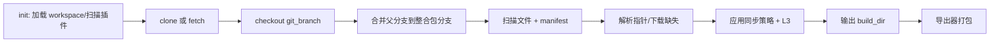

# 构建流水线

`NeoBuild::BuildEngine` 把仓库构建为输出目录；导出器再把输出打包。

## 步骤

| 步骤 | 入口 | 说明 |
|---|---|---|
| init | `BuildEngine::init` | 加载 workspace、导出器、解析器、指针解析器 |
| clone/fetch | `stepCloneOrFetch` | 本地仓库无 remote 时跳过 fetch |
| checkout | GitOperations | 用 `git_branch`，不是整合包分支 |
| merge | `BranchMerger` | 按 parent 链合并，子覆盖父，处理 delete/override |
| scan | 文件扫描 | 生成文件清单与哈希 |
| pointer | `PointerDownloader` | 缺失文件解析下载，缓存复用 |
| sync policy | `SyncPolicyExecutor` | mirror/incremental/skip/partial |
| export | `IModpackExporter` | nsum/mcbbs/modrinth/hmcl |

## 分支与 git 分支

- **checkout 用 Git 分支**（如 `main`）；
- **merge 用整合包分支**（如 `base`/`client`）；
- 两者混淆会报 `pathspec ... did not match`。

## 输出目录

- GUI 预览：系统临时目录 `%TEMP%/NSUM-virtual-build/<分支>/`；
- 实际构建：用户指定导出目录/实例目录；
- 发布包构建：`build/` 下的构建输出再交给导出器。

## 失败模式

| 现象 | 原因 | 处理 |
|---|---|---|
| 分支切换失败 | git 分支不存在/名称混淆 | 检查 `--git-branch` |
| 指针解析失败 | resolver 未加载/URL 失效 | 检查 `pointers/` 与指针内容 |
| 导出失败 | 扩展名/字段非法 | 检查导出器 meta 与参数 |
| 文件被误删 | mirror 策略 | 检查保护清单/策略 |

## 相关

- [同步引擎](./sync-engine.md)
- [指针系统](./pointer-system.md)
