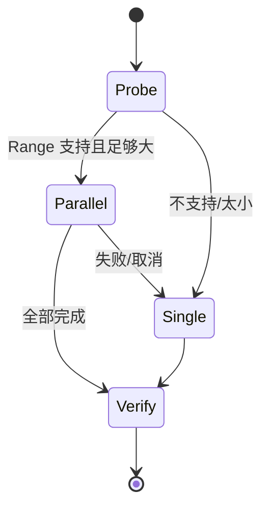

# 下载器

## 探测

- 先 HEAD 探测 `Content-Length`/`Accept-Ranges`；
- HEAD 失败（部分 CDN/代理）回退 `GET Range: bytes=0-0` + `Content-Range`；
- 支持 Range 且大小 ≥ 阈值才启用分片。

## 分片

- 按 `threads` 切片，`QFile::resize` 预分配后定位写；
- 单服务器最多 32 路并发（进程内限制）；
- 任一分片失败/取消：删除目标并返回失败。

## 回退

`PointerDownloader::downloadToPath` 先尝试并行，失败后用 QNAM 单流。

## 配置

| 环境变量 | 默认 | 说明 |
|---|---|---|
| `NSUM_DOWNLOAD_THREADS` | 16 | 分片数（1–16） |
| `NSUM_DOWNLOAD_MIN_SIZE_MB` | 8 | 小于该值走单流 |
| `NSUM_DOWNLOAD_CHUNK_MB` | 0 | 0=自动 |
| `NSUM_DOWNLOAD_RETRIES` | 2 | 重试次数 |
| `NSUM_DOWNLOAD_PARALLEL` | 1 | 0 关闭并行 |

## 代理/受限网络

- 并发下载在部分代理下会 0 字节悬挂 → 必须有超时并回退；
- 回退链：并行 → 单流 → 调用方兜底（curl/PowerShell）；
- 日志记录每个分片范围与失败原因。

## 相关

- [指针系统](./pointer-system.md)
- [bridge 下载](../../extensions/client-bridge/download.md)
