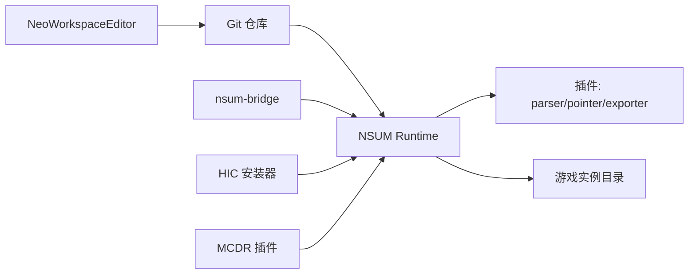

# 架构与原理

本分组解释 NSUM **为什么这样设计**、**数据如何流动**、**失败时会发生什么**。所有结论以当前源码为准（Runtime 1.0.5 / internal 0.1.11）。

## 阅读顺序

1. [总体架构](./overview.md)：组件、进程边界、数据流；
2. [设计目标](./design-goals.md)：约束、取舍、非目标；
3. [数据模型](./data-model.md)：workspace / branch / manifest / pointer / cache；
4. [构建流水线](./build-pipeline.md)；
5. [同步引擎](./sync-engine.md)：L1/L2/L3；
6. [指针系统](./pointer-system.md)；
7. [下载器](./downloader.md)；
8. [安全](./security.md)。

## 一页概览

| 层 | 组件 | 职责 |
|---|---|---|
| 入口 | CLI / GUI / bridge / 安装器 / MCDR | 触发构建/同步 |
| 引擎 | NeoWorkspace + NeoBuild | 仓库、分支、合并、同步、导出 |
| 扩展 | parser/pointer/exporter DLL | 配置合并、下载解析、格式导出 |
| 数据 | 仓库 + 缓存 + 实例 | 唯一事实来源与派生产物 |

## 设计关键词

- **仓库即事实源**：所有内容在 Git 中可审计、可回滚；
- **内容寻址**：大文件按 SHA-256 引用，天然去重；
- **零信任缓存**：每次使用缓存前重新校验；
- **清单型分发**：`.nsumpack` 默认只带清单，客户端按仓库同步；
- **失败显式**：同步失败中止启动，不静默带旧内容。

## 图源

- [Mermaid 源文件与 SVG 导出](../../../../assets/diagrams/README.md)
