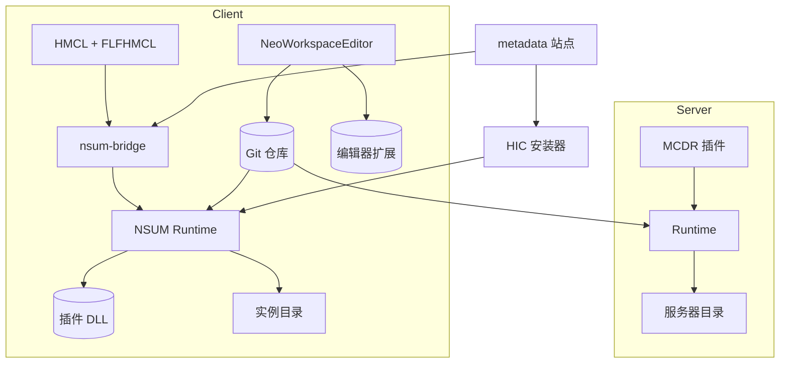
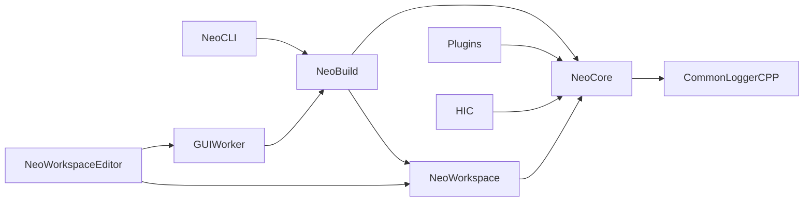

# 总体架构

NSUM 由多个进程/组件组成，围绕一个 Git 仓库工作。

## 组件

| 组件 | 形态 | 职责 |
|---|---|---|
| NSUM Runtime | `NeoServerUpdateModpack.exe` + `deploy/` | 构建、同步、导出、下载、CLI |
| GUI | 同 EXE（无参数） | 向导/构建页 |
| CLI | 同 EXE（`info/flow/exec`） | 无界面操作与 JSON |
| nsum-bridge | HMCL 扩展 jar | NSUM 页面、启动注入、Runtime 安装 |
| HIC 安装器 | 独立 EXE | 安装 Runtime/Editor、内置 Git |
| NeoWorkspaceEditor | 独立 EXE | 仓库内容编辑器 + CLI |
| MCDR 插件 | Python 插件 | 服务端核心安装/同步 |
| 插件 DLL | `parsers/pointers/exporters/editor/extension` | 解析、下载、导出、编辑扩展 |

## 进程与数据流

## 模块分层

- **NeoCore**：接口（IConfigParser/IPluginPointer/IModpackExporter）、PluginLoader、路径、并行下载器；
- **NeoWorkspace**：workspace.json、分支、Git 操作、同步策略；
- **NeoBuild**：构建引擎、分支合并、指针下载、serverconfig、导出器加载；
- **NeoCLI/GUIWorker**：CLI 与 GUI 的领域层；
- **插件**：以 DLL 形式在运行时加载。

## 数据目录

| 目录 | 内容 |
|---|---|
| `.hmcl/nsum/runtime/` | Runtime |
| `.hmcl/nsum/repos/` | 克隆的仓库 |
| `.hmcl/nsum/cache/files/` | 内嵌文件缓存（SHA-256） |
| `.minecraft/versions/.cache/` | 构建侧指针缓存（SHA-256） |
| `config/history/` | GUI 历史与远程缓存 |

## 关键约束

- Runtime 不依赖系统 Git（内置 MinGit）；
- 插件与宿主通过导出符号交互，跨 DLL 传递 STL/Qt 对象有严格约束（见 [ABI](../framework/abi.md)）；
- 所有路径以 UTF-8 处理（Windows argv 重建）；
- 同步失败默认中止启动。

## 相关

- [设计目标](./design-goals.md)
- [数据模型](./data-model.md)
