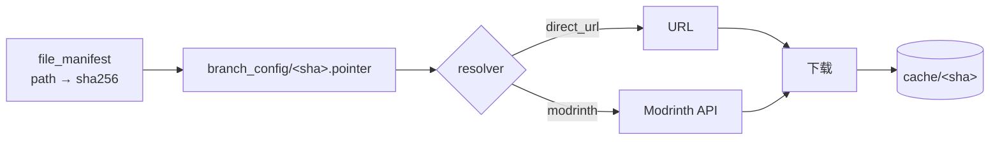

# 指针系统

## 结构



## 指针文件

```json
{
  "resolver": "direct_url",
  "metadata": { "url": "https://example.com/a.jar" },
  "sha256": "<64 hex>",
  "size": 1234
}
```

- 文件名 = 目标内容 SHA-256；
- 指针不含目标路径；路径由 `file_manifest` 关联；
- `pointer_files` 段保存 resolver 与 metadata（与 `.pointer` 同步）。

## 解析

1. 构建扫描发现目标路径缺少文件或哈希不匹配；
2. 从 `file_manifest` 取哈希 → 找 `branches/.../` 内容或缓存；
3. 缓存命中则校验后直接复制；
4. 未命中则用 resolver 解析 URL，下载、校验、写缓存。

## 缓存

| 位置 | 用途 |
|---|---|
| `.minecraft/versions/.cache/<sha256>` | 构建侧 |
| `.hmcl/nsum/cache/files/<sha256>` | bridge 内嵌文件 |

## 零信任

- 每次使用缓存前重新计算 SHA-256；
- 不匹配则删除并重新下载；
- 防止磁盘损坏、并发写坏、静默篡改。

## 失败模式

| 现象 | 原因 |
|---|---|
| `No resolver found` | 解析器缺失/`resolver` 名错 |
| `SHA-256 hash mismatch` | 缓存损坏/下载被篡改 |
| URL 404 | 直链失效（direct_url） |

## 扩展

新增下载源 = 实现 `IPluginPointer` + 导出 `CreatePointer()` + meta.json，放入 `pointers/`。

## 相关

- [下载器](./downloader.md)
- [指针（作者）](../../pack-author/pointers.md)
