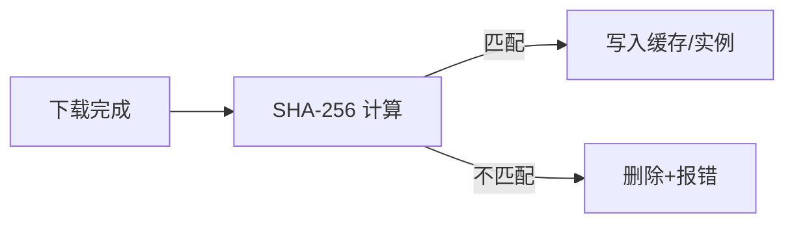

# 安全

NSUM 处理来自网络的仓库、模组与安装包，安全边界必须显式。

## 威胁模型

| 威胁 | 缓解 |
|---|---|
| 下载内容被篡改 | SHA-256 校验（指针/内嵌文件/metadata） |
| 路径穿越 | 仓库/实例相对路径限制，拒绝 `..` |
| 编码混淆 | 全链路 UTF-8（argv/exeDir/QProcess） |
| 误删实例文件 | mirror 删除保护清单 |
| 凭据泄露 | 不记录 token；git 环境禁止交互提示 |
| 供应链 | 发布包 SHA-256 + GitHub Release + metadata |

## 路径规则

- CLI `--repo` 与编辑器路径限定在仓库内；
- 图像/文档占位不写入仓库外路径；
- `file_manifest` 相对路径使用 `/`（`generic_u8string`）；
- Windows 中文路径由 `fsu8` 统一处理。

## 内容校验

- 内嵌文件按 `embedded[]` 的 sha256；
- 指针按 `sha256` 字段；
- Runtime 包按 metadata 的 `sha_256`。

## 凭据

- git 操作设置 `GIT_TERMINAL_PROMPT=0` / `GCM_INTERACTIVE=never`，避免挂起；
- 不把 token 写入日志/文档；
- 私有仓库使用系统凭据管理器，不内置账号。

## 发布链

1. 构建产物 zip；
2. `gh release` 上传；
3. metadata 记录 `sha_256`/`size_bytes`；
4. 客户端下载后校验 SHA-256。

## 限制

- 不验证作者身份（依赖 GitHub 账号）；
- 不签名 jar/模组；
- 不阻止玩家本地修改（零信任只针对内容一致性）。

## 相关

- [设计目标](./design-goals.md)
- [发布流程](../release.md)
