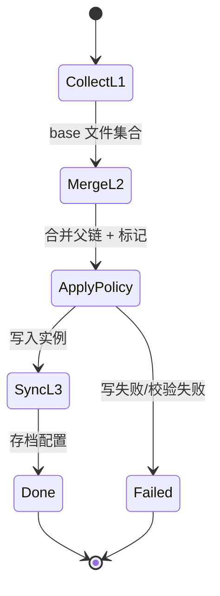

# 同步引擎

## 三层

| 层 | 来源 | 写入目标 | 说明 |
|---|---|---|---|
| L1 | 基础分支（base） | 实例 | 共享内容 |
| L2 | 整合包分支（含父链） | 实例 | 覆盖与最终产物 |
| L3 | 存档 serverconfig | `saves/<save>/serverconfig` | 按存档同步 |

## 状态机

## 策略执行

| 策略 | 行为 |
|---|---|
| `skip` | 不写 |
| `mirror` | 清空重写 + 删除多余（受保护清单约束） |
| `incremental_add` | 只补缺失 |
| `incremental_overwrite` | 补缺失 + 覆盖已存在 |
| `default` | 使用父级/顶层默认 |
| `partial`（文件） | 经 parser 合并 tracked_keys/tracked_lines |

## 文件标记

- `delete`：合并时删除父分支同名文件；
- `override`：强制覆盖；
- 标记记录在分支清单，随仓库版本化。

## 删除保护

`mirror` 删除前保护：

- 根级 `options.txt`、`log4j2.xml`、`natives*`、根级 `*.jar`；
- `saves/`；
- 显式策略路径；
- 实例标记文件（`.NSUM/`、`<id>.json`、`icon.*`）。

## L3 serverconfig

- 仓库路径 `branches/<branch>/save/[save]/serverconfig/`；
- `.rule/globle.json` 定义默认模式，`.rule/list.json` 定义文件清单；
- 同步到 `<实例>/saves/<save>/serverconfig/`。

## 失败模式

| 现象 | 原因 | 处理 |
|---|---|---|
| 同步后文件全没了 | mirror + 路径算错/目标为空 | 检查 UTF-8 路径与目标目录 |
| 玩家配置被覆盖 | full/partial 策略配置错误 | 改为 partial + tracked_keys |
| L3 未生效 | 存档名/路径不匹配 | 检查 `[save]` 与 `.rule` |

## 相关

- [数据模型](./data-model.md)
- [同步规则（作者）](../../pack-author/sync-rules.md)
