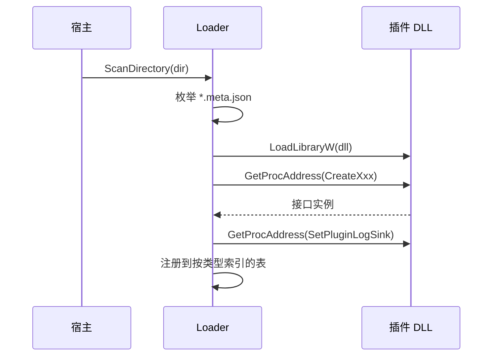

# 扩展注册表

NSUM 没有单一“扩展注册表”，而是按类型各有扫描/加载点；理解它们才能正确放置插件。

## 加载点

| 类型 | 加载者 | 目录 | 选择方式 |
|---|---|---|---|
| 配置解析器 | `NeoCore::PluginLoader` | `parsers/` | 扩展名 + `priority` |
| 指针解析器 | `NeoBuild::PointerDownloader` | `pointers/` | `resolver` 名 |
| 导出器 | `NeoBuild::ModpackExporter` | `exporters/` | `format` 名 |
| 编辑器配置扩展 | 编辑器扩展注册表 | `editor/extension/parsers/` | 扩展名 |
| 编辑器指针扩展 | 同上 | `editor/extension/pointers/` | resolver 名 |
| HIC 拓展 | `hci::ExtensionLoader` | 安装器拓展目录 | 注册的步骤/服务 |

## 加载时序

## 命名约定

- 插件 DLL：`<Type>_<Name>.dll`；
- meta：同名 `*.meta.json`（剥离 `.meta.json` 再拼 `.dll`）；
- 工厂：`CreateParser` / `CreatePointer` / `CreateExporter` / `CreateConfigEditor` / `CreateEditorExtension`。

## 失败与隔离

| 情况 | 行为 |
|---|---|
| DLL 缺失 | 跳过，日志 `DLL missing` |
| 工厂导出缺失 | 跳过（`CreateXxx not found`） |
| meta 非法 | 跳过该插件 |
| 插件崩溃 | 宿主无法隔离（同进程），需修复插件 |

## 生命周期

- 宿主初始化时扫描一次；插件对象由宿主持有；
- 插件不得在 DLL 卸载后继续使用宿主回调；
- 更新插件需重启宿主（编辑器/运行时）。

## 相关

- [插件契约](./plugin-contracts.md)
- [ABI](./abi.md)
