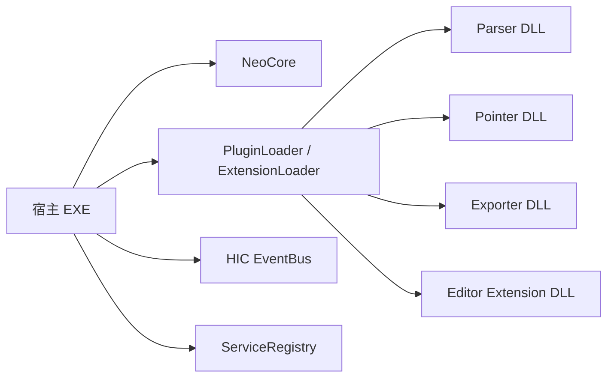

# 基础框架 / 总线 / ABI

本分组讲清“扩展如何接入”：

1. [基础框架](./base-framework.md)：NeoCore 提供的接口、路径、日志、取消与错误；
2. [模块布局](./module-layout.md)：target 类型、依赖方向、产物位置；
3. [事件总线](./event-bus.md)：HIC `EventBus`/`ServiceRegistry` 的真实 API 与线程语义；
4. [扩展注册表](./extension-registry.md)：插件发现、加载、注册与生命周期；
5. [插件契约](./plugin-contracts.md)：parser/pointer/exporter/editor-extension 四类契约；
6. [ABI](./abi.md)：导出符号、跨 DLL 边界、布局与版本兼容。

## 关系图

## 核心原则

- 插件只依赖 `NeoCore` 的**接口头文件**；
- 插件通过 `extern "C"` 工厂导出创建函数；
- 宿主注入日志（`SetPluginLogSink`），插件不自行初始化日志；
- 跨 DLL 不传递 STL 容器/Qt 对象（除非 ABI 明确约定）。

## 相关

- [模块参考](../Modules/_meta.json)
- [模块文档规范](../../../../_meta/style-guide.md)
