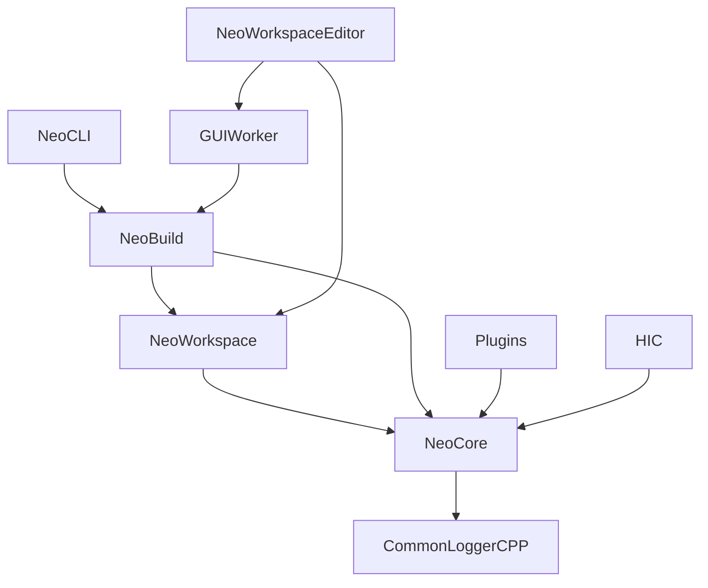

# 模块布局

## 类型

| 类型 | 示例 | CMake |
|---|---|---|
| 基础库（STATIC） | NeoCore/NeoWorkspace/NeoBuild/CommonLoggerCPP | `add_library(... STATIC)` |
| 插件（SHARED） | NeoParser_*/NeoPointer_*/NeoExporter_* | `add_library(... SHARED)` |
| 可执行（EXE） | 主程序、NeoWorkspaceEditor、PowerHelper | `add_executable` |
| 安装器 | HiBerCommonInstaller 的三壳 | `add_executable` |

## 依赖方向

- 依赖只能**向下**：引擎依赖基础，插件依赖接口；
- 插件不得链接主程序/引擎（只依赖 NeoCore 接口）；
- GUI 不直接调用 Git/网络（走领域层）。

## 产物

| 产物 | 位置 |
|---|---|
| `NeoServerUpdateModpack.exe` | `build/deploy/` |
| 插件 DLL + meta | `build/deploy/{parsers,pointers,exporters}/` |
| 编辑器扩展 | `build/deploy/editor/extension/` |
| 文档 | `build/deploy/docs/{zh,en}/` |
| 安装器 | `build_nsum_installer/NSUM_Installer_<版本>.exe` |

## 版本注入

根 `CMakeLists.txt` 读取 `version.json`，注入宏：

- `NSUM_EXTERNAL_VERSION`
- `NSUM_INTERNAL_VERSION`
- `NSUM_FULL_VERSION`
- `NSUM_GIT_COMMIT`

所有 target 共享；改宏后需重新 configure（必要时 clean）。

## 共享头文件规则

- 修改被多 target 包含的头文件（类成员/接口）后，所有引用 target 必须重建；
- 布局失配的典型症状：关闭时 `HEAP CORRUPTION 0xC0000374`、`0xC0000005`；
- 不信 ninja “no work to do”，核对 obj 时间戳。

## 相关

- [ABI](./abi.md)
- [构建](../testing.md)
