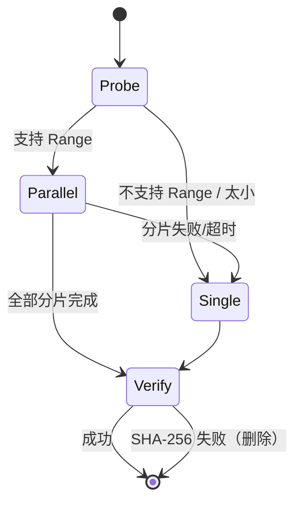

# bridge 下载

bridge 的 `NSumParallelDownloader` 负责下载 Runtime 包与内嵌文件，策略与运行时 C++ 并行下载器一致但实现独立（Java）。

## 探测

- 先 `GET` + `Range: bytes=0-0` 探测（**不要用 HEAD**：`HttpURLConnection` 的 HEAD 不跟随 GitHub 302）；
- 读取 `Content-Range` 得到总大小与 `Accept-Ranges`。

## 分片

- 支持 Range 且大小 ≥ 阈值时按线程数切片；
- 用 `FileChannel.write(buffer, position)` 定位写；
- 进程内 `Semaphore` 限制同一服务器最多 32 连接；
- 全部完成后校验大小。

## 回退与超时

- **必须有总时限（10 分钟）**；
- 任一分片失败立即 `shutdownNow`，删除目标并回退单流；
- 单流也失败时向上抛出，由调用方提示。

> 实测：本机代理下并发分片可能长时间 0 字节悬挂，Java 版曾跑 11 小时；因此超时与回退是硬性要求。

## 配置

`<HMCL>/.hmcl/nsum/download.properties`：

```properties
threads=8
minSizeMB=8
enabled=true
```

或 JVM 参数：

```text
-Dnsum.download.threads=8
-Dnsum.download.minSizeMB=8
-Dnsum.download.enabled=false
```

| 键 | 默认 | 说明 |
|---|---|---|
| `threads` | 8 | 分片数（上限 16） |
| `minSizeMB` | 8 | 小于该大小走单流 |
| `enabled` | true | 关闭后全部单流 |

## 状态机



## 内嵌文件缓存

- `.nsumpack` 的 `embedded[]` 文件按 SHA-256 存入 `.hmcl/nsum/cache/files/`；
- 命中缓存直接复制并校验；
- 未命中才从包内解压，校验后入缓存。

## 相关

- [任务链](./tasks.md)
- [.nsumpack](../../pack-author/nsumpack.md)
