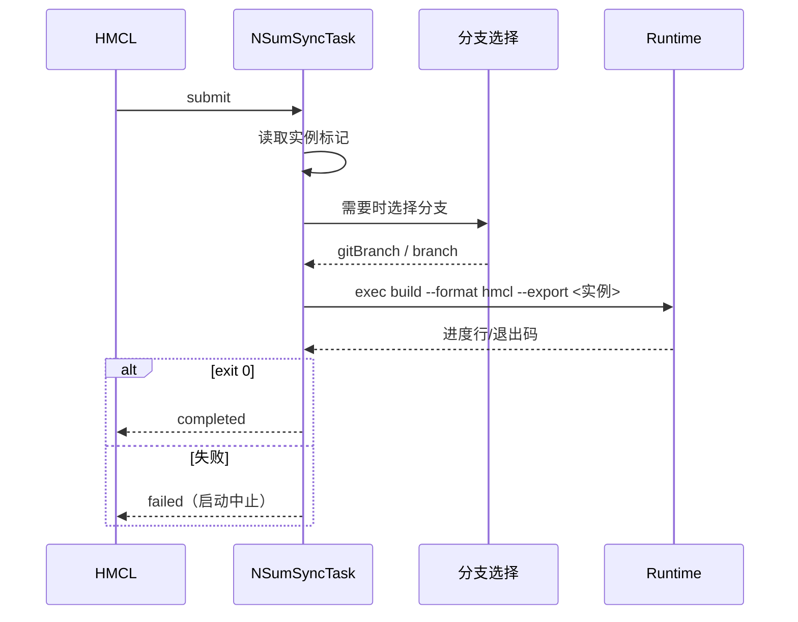

# bridge 任务链

## 注入点

bridge 通过 Mixin 包装 HMCL 的启动检查：

```text
LauncherHelper.checkGameState(HMCLGameRepository, GameSettings.Effective, Version)
```

返回一个新的任务链：

```text
NSumSyncTask("NSUM 更新检查") → 原 checkGameState 结果
```

这样 NSUM 同步发生在**启动流程第一步**，失败即中止。

## 任务链



## 进度 UI

- 同步任务显示在 HMCL 任务对话框；
- bridge 面板挂到 `task-executor-dialog-layout` 的 VBox 顶部（不是独立窗口）；
- 面板缓存最后一次状态，挂载前设置的状态不会丢失；
- 可取消：取消会中断 Runtime 进程。

## 取消

- HMCL 取消会中断任务线程；
- bridge 检测 `Task.isCancelled()` 后 `destroyForcibly()` Runtime 进程；
- 取消后不再启动游戏。

## 失败处理

| 情况 | 行为 |
|---|---|
| Runtime 返回非 0 | 任务失败，启动中止 |
| 下载/同步异常 | 显示错误摘要并写日志 |
| `launchOnSyncFailure=true` | 允许带旧内容启动 |

## 分支选择对话框

- 数据：`info git-branches --json`、`info modpacks --json`；
- 仅一个候选时自动跳过；
- 选择结果写回实例标记。

## 注意

- 注入失败（Mixin 版本不匹配）会导致 NSUM 页面存在但启动不检查，需匹配 HMCL/FLF 版本；
- 同步任务必须避免阻塞 HMCL UI 线程；
- 任务链失败不能静默，否则玩家会带旧内容进入服务器。

## 相关

- [使用](./usage.md)
- [同步与启动](../../user/sync-and-launch.md)
