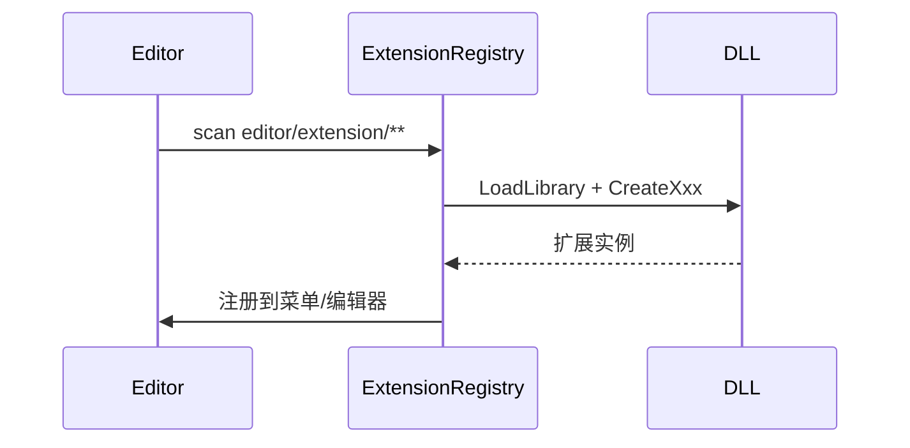

# 编辑器扩展

编辑器（`NeoWorkspaceEditor.exe`）的扩展放在 `editor/extension/`，分两类：

| 目录 | 接口 | 扩展 |
|---|---|---|
| `editor/extension/parsers/` | `NeoCore::IConfigEditorExtension` | JSON/YAML/TOML/SNBT/TXT/Properties |
| `editor/extension/pointers/` | `NeoCore::IPointerEditorExtension` | DirectURL/Modrinth |

## 加载流程

- 启动时扫描；DLL 与 `*.meta.json` 必须配对；
- `CreateXxx` 必须 `__declspec(dllexport)`；
- 加载失败会跳过并在日志中记录（不影响主界面）。

## 菜单

「扩展」菜单按扩展类型分组：配置编辑器、指针解析器；点击后可查看/编辑对应设置。

## 编写扩展

1. 实现 `IConfigEditorExtension` 或 `IPointerEditorExtension`；
2. 导出工厂（名称以头文件为准）；
3. 提供 `*.meta.json`（name/version/dll/扩展名）；
4. 放入对应目录，重启编辑器。

## 与运行时插件的关系

编辑器扩展与运行时插件**实现不同的接口**（编辑器接口 vs `IConfigParser`/`IPluginPointer`），但通常成对发布：

- `NeoParser_JSON.dll`（运行时）↔ `NeoEditorExtension_Parser_JSON.dll`（编辑器）；
- `NeoPointer_Modrinth.dll`（运行时）↔ `NeoEditorExtension_Pointer_Modrinth.dll`（编辑器）。

## 相关

- [配置解析器扩展](./parser-extensions.md)
- [指针解析器扩展](./pointer-extensions.md)
