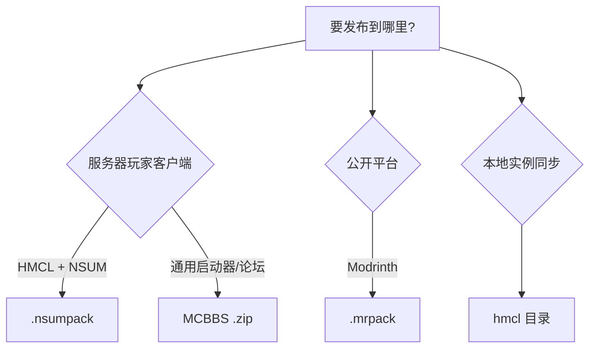

# 导出器

导出器（exporter）把构建产物打包为分发格式。NSUM 内置四种：

| 导出器 | format | 扩展名 | 用途 |
|---|---|---|---|
| NeoExporter_MCBBS | `mcbbs` | `.zip` | MCBBS / PCL / HMCL 通用整合包 |
| NeoExporter_Modrinth | `modrinth` | `.mrpack` | Modrinth 格式（发布到 Modrinth） |
| NeoExporter_HMCL | `hmcl` | （目录） | 同步到 HMCL 工作目录/实例 |
| NeoExporter_NSUM | `nsum` | `.nsumpack` | NSUM 清单型整合包（服务器分发） |

## 契约

实现 `NeoCore::IModpackExporter`（`modules/NeoCore/include/IModpackExporter.h`）：

| 方法 | 作用 |
|---|---|
| `metadata()` | 格式名/扩展名/字段声明（GUI 表单） |
| `export_modpack(input)` | 执行导出，返回产物路径与警告 |
| `preview_structure(input)` | 预览导出结构（不写盘） |

工厂导出：

```cpp
extern "C" __declspec(dllexport) NeoCore::IModpackExporter* CreateExporter();
```

## 选择建议



## 加载与目录

- 运行时扫描 `exporters/`；
- DLL + `*.meta.json` 必须同名配对；
- `fields` 决定 GUI/CLI 的额外信息表单；`--embed-patterns` 仅 NSUM 导出器支持。

## 相关

- [MCBBS](./mcbbs.md) · [Modrinth](./modrinth.md) · [HMCL](./hmcl.md) · [NSUM](./nsum.md)
