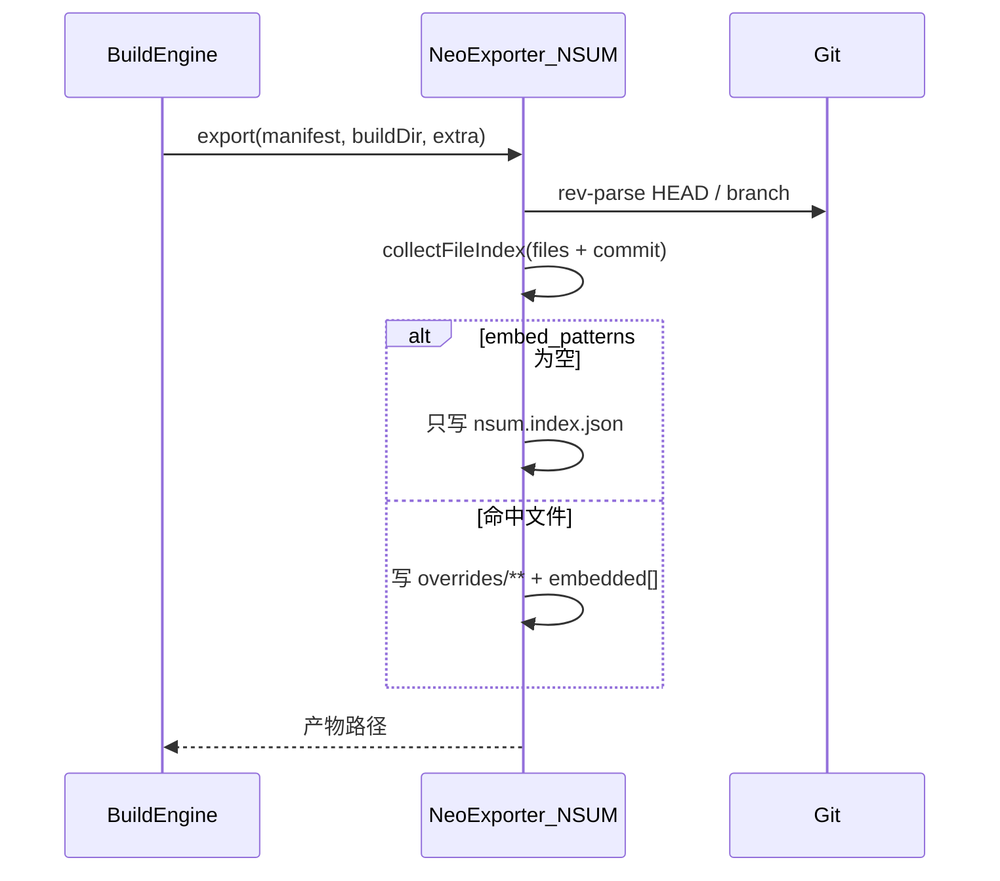

# NSUM 导出器

`NeoExporter_NSUM` 生成 `.nsumpack`：**默认只含清单**（仓库信息 + 文件索引），文件由客户端按仓库同步。只有显式声明 `embed_patterns` 时才把命中文件放入 `overrides/`。

## 元数据

| 项 | 值 |
|---|---|
| format | `nsum` |
| 扩展名 | `.nsumpack` |
| 必填字段 | `name`、`version` |
| 可选字段 | `author`、`description`、`embed_patterns`（高级，多行） |

## 产物结构

```text
<pack>.nsumpack
├─ nsum.index.json          # 清单（约 1 KB）
└─ overrides/**             # 仅 embed_patterns 命中时存在
```

`nsum.index.json`（`pack_format: 2`）核心字段：

| 字段 | 说明 |
|---|---|
| `pack_format` / `schema` | `2`，文件结构版本 |
| `type` | `nsum` |
| `name` / `version` / `author` / `description` | 整合包元数据 |
| `gameVersion` / `modloader` / `modloaderVersion` | 游戏与加载器 |
| `repository.url` | 仓库地址 |
| `repository.default_branch` | 默认 Git 分支 |
| `repository.branch` | 整合包分支 |
| `repository.git_branch` | 构建使用的 Git 分支 |
| `repository.commit` | 构建时提交 ID |
| `files[]` | `path`/`size`/`sha256`/`commit`/`git_branch`（只登记） |
| `embedded[]` | 实际内嵌文件 + `pattern` + `sha256` + 来源提交 |
| `embed_patterns[]` | 本次声明的正则 |
| `runtime.minVersion` | Runtime 最低版本 |

## 内嵌规则

- 正则作用于**仓库相对路径**（如 `config/a.json`），ECMAScript 语法，`search` 语义；
- 多个正则用换行或 `;` 分隔；
- `save/` 永不内嵌；
- 非法正则会导致导出失败（不静默）。

```powershell
# 默认：只登记，不内嵌
NeoServerUpdateModpack.exe exec build --repo <仓库> --modpack base --git-branch main `
    --format nsum --export plain.nsumpack

# 显式内嵌 config 下的 json
NeoServerUpdateModpack.exe exec build --repo <仓库> --modpack base --git-branch main `
    --format nsum --embed-patterns '^config/.*\.json$' --export embed.nsumpack
```

## 导出时序



## 客户端行为

- bridge 解析 `repository` 与 `embedded[]`；
- `embedded[]` 文件按 SHA-256 缓存到 `.hmcl/nsum/cache/files/`，跨整合包复用；
- 无 `embedded` 字段的旧包回退解压全部 `overrides/`。

## 与旧格式差异

| 版本 | 行为 |
|---|---|
| pack_format 1（旧） | 无条件把构建产物写入 `overrides/`，包体积大 |
| pack_format 2（当前） | 默认清单型；内嵌需显式声明并登记来源 |

## 相关

- [`.nsumpack` 格式（作者视角）](../../pack-author/nsumpack.md)
- [构建与导出](../../pack-author/build-and-export.md)
