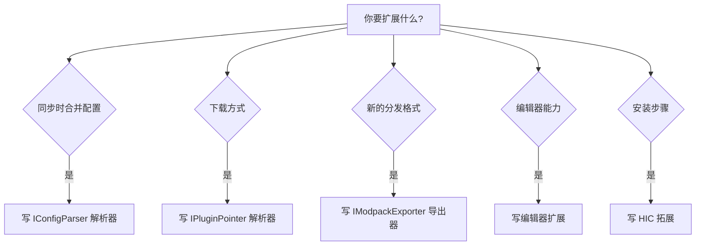

# 拓展功能

NSUM 的核心是“仓库 + 同步 + 启动”，其余能力以拓展形式提供。本板块按类型分组：

## 分组

| 分组 | 内容 | 运行位置 |
|---|---|---|
| [配置解析器](./parsers/index.md) | JSON/YAML/TOML/SNBT/TXT/Properties | Runtime 同步 |
| [指针解析器](./pointers/index.md) | DirectURL/Modrinth | Runtime 下载 |
| [导出器](./exporters/index.md) | MCBBS/Modrinth/HMCL/NSUM | 构建导出 |
| [编辑器扩展](./editor/index.md) | 配置/指针编辑扩展 | NeoWorkspaceEditor |
| [安装器](./installer/index.md) | HIC 壳与 git/winget/apt 拓展 | 安装器 |
| [客户端 bridge](./client-bridge/index.md) | HMCL 集成、启动注入、下载 | HMCL |
| [服务端插件](./server-plugin/index.md) | MCDR 核心安装/同步/配置 | 服务器 |
| [基础库](./libraries/index.md) | CrashTracker/PowerHelper/GUI 库/忽略标记 | 通用 |
| [MCLHR](./mclhr.md) | mod store 与硬链接投影 | Runtime + bridge |

## 选择指南

## 加载目录

| 拓展 | 目录 |
|---|---|
| 解析器/指针/导出器 | `<runtime>/parsers`、`pointers`、`exporters` |
| 编辑器扩展 | `<runtime>/editor/extension/{parsers,pointers}` |
| HIC 拓展 | 安装器 `extensions` 目录 |
| bridge | HMCL `mods/` |
| MCDR 插件 | 服务器 `plugins/` |

## 相关

- [开发者：插件契约](../developer/framework/plugin-contracts.md)
- [开发者：模块参考](../developer/Modules/_meta.json)
