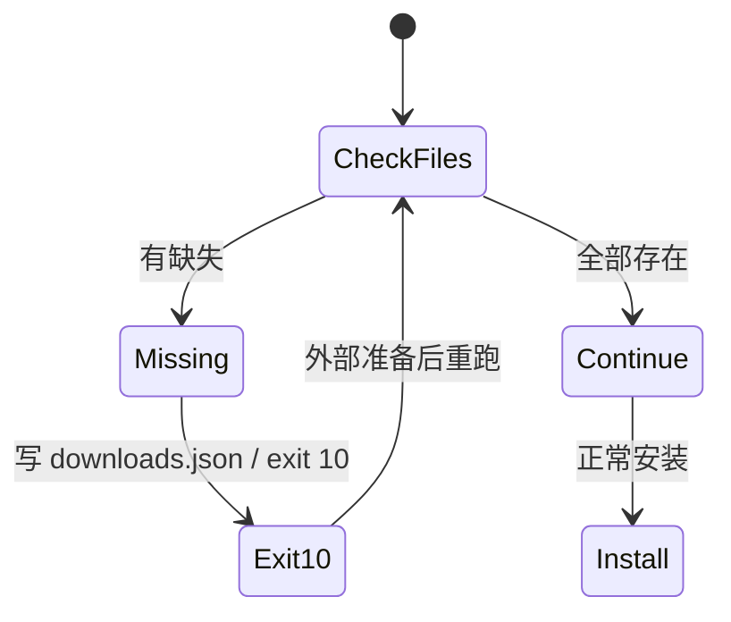

# 外部下载模式

用于受限网络/离线安装：安装器**不自己下载**，而是把需要的文件列出来，由外部工具准备好后再重跑。

## 契约

```powershell
hci_cli.exe --external-download <目录> --silent --cli
```

1. 每个 `download` 步骤先检查 `<目录>/files/<文件名>` 是否存在且大小匹配；
2. 缺失文件写入 `<目录>/downloads.json`；
3. 流程返回 **2**，CLI 退出码 **10**；
4. 外部准备好 `<目录>/files/*` 后重跑同一命令即可完成安装。

## downloads.json

```json
{
  "downloads": [
    {
      "name": "deploy.zip",
      "url": "https://example.com/deploy.zip",
      "size": 53083322,
      "sha256": "..."
    }
  ]
}
```

## 状态机



## 注意

- 该暂停必须绕过步骤 `optional`：不能因为 optional 被忽略而继续安装；
- JSON 模式会输出 `hci/downloads-required` 块；
- `files/` 中的文件名必须与清单一致；
- 大小校验失败视为缺失（会重新列出）。

## 相关

- [CLI](./cli.md)
- [流程脚本](./flow.md)
