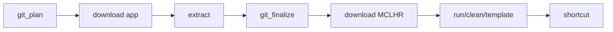

# 流程脚本

HIC 安装流程是 JSON：`product.json` 定义产品与默认值，`install.json`/`uninstall.json`/`upgrade.json`/`repair.json` 定义步骤序列。

## 结构

```json
{
  "id": "install",
  "steps": [
    { "type": "download", "url": "...", "dest": "${installDir}/pkg.zip" },
    { "type": "extract", "source": "${installDir}/pkg.zip", "dest": "${installDir}" }
  ]
}
```

## 步骤类型

| 类型 | 作用 |
|---|---|
| `download` | 下载（cpr → curl 分段 → PowerShell 单流回退） |
| `extract` | 解压 zip |
| `copy` | 复制文件/目录 |
| `clean` | 清理目标（支持 `skip`） |
| `run` | 运行外部命令 |
| `script` | 内嵌脚本/命令序列 |
| `template` | 写入模板文件 |
| `shortcut` | 创建快捷方式（可禁用） |
| `registry` | 写注册表 |
| `git_plan` | 规划内置 Git（复用/下载） |
| `git_finalize` | 定位 Git 并写路径 |
| `git_refresh` | 刷新 Git 环境 |

> `git_*` 由 `ext/git` 拓展提供；其他拓展可注册额外类型，未知类型会报 `unknown step type: <x>`。

## 变量

- `${installDir}`、`${productDir}` 等内置变量；
- 产品/用户输入写入变量（如 `${editor}`）；
- 变量在步骤字段中插值。

## 条件与可选

```json
{
  "type": "download",
  "url": "https://example.com/editor.zip",
  "when": "vars.withEditor == 'true'",
  "optional": true
}
```

- `when`：Lua 表达式，为假时跳过；
- `optional`：失败只警告，继续后续步骤；
- 外部下载暂停（exit 10）优先于 `optional` 逻辑（不能被 optional 吞掉）。

## NSUM 流程



## 注意

- 步骤顺序即执行顺序；下载失败默认终止流程；
- `clean` 使用 `skip` 保护 `tools/`（避免删掉刚装的 Git）；
- 改流程后需同步 `install_cli.json`（无 GUI 版本）。

## 相关

- [CLI](./cli.md)
- [外部下载模式](./external-download.md)
