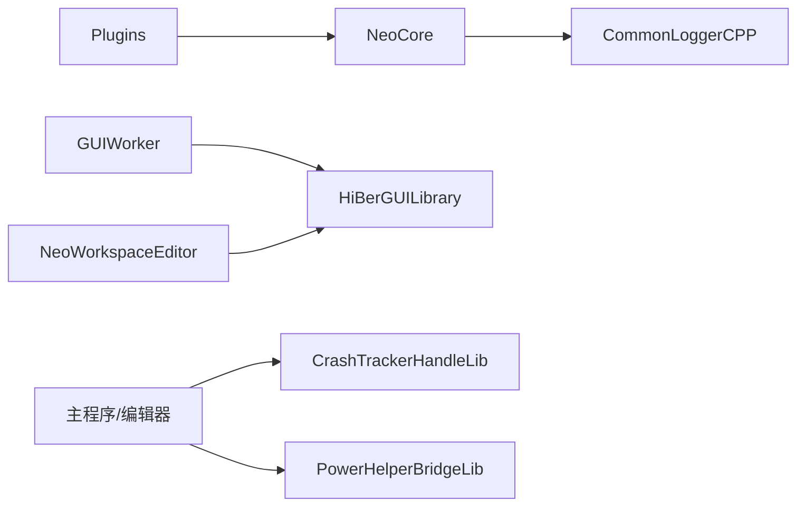

# 基础库

这些库不属于 NSUM 业务，但被主程序/编辑器/安装器复用，均以独立仓库形式维护。

| 库 | 作用 | 形态 |
|---|---|---|
| CrashTracker | 崩溃捕获与离线分析 | EXE + 静态库 |
| PowerHelper | Markdown 文档阅读器（WebView2） | DLL + EXE |
| HiBerGUILibrary | 通用 Qt 组件（树、进度、Git 面板等） | STATIC |
| GitIgnoreMarkup | `.gitignore` 标记/逆向标记与编辑 GUI | STATIC + GUI |

## 依赖方向

## 页面

- [CrashTracker](./crashtracker.md)
- [PowerHelper](./powerhelper.md)
- [HiBerGUILibrary](./guibergui.md)
- [GitIgnoreMarkup](./gitignore-markup.md)
