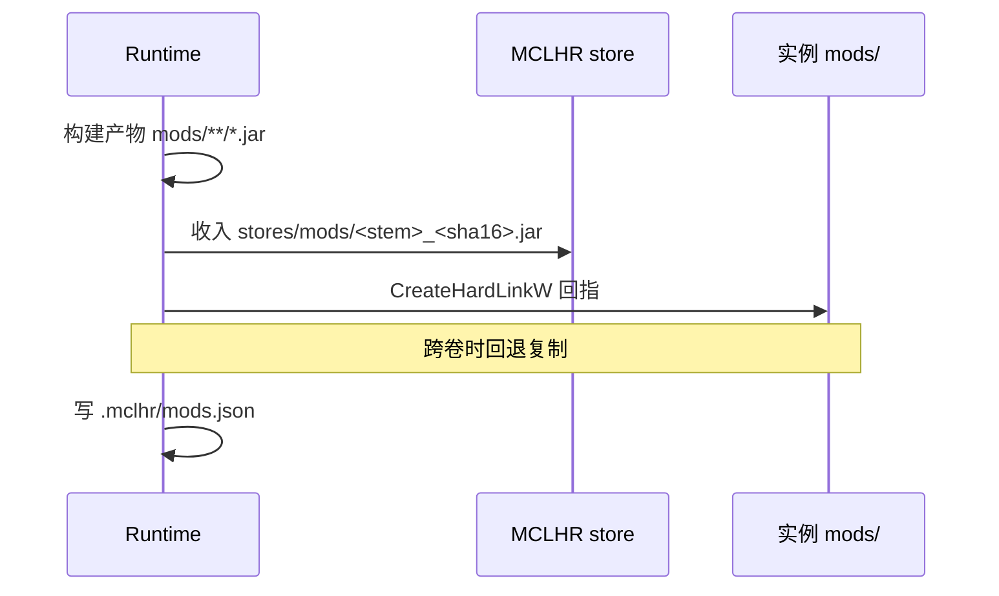

# MCLHR 集成

MCLHR（`mclhr.jar`）负责“库坐标 → 多 store → 启动计划”，NSUM 用它在同步后把共享 mod 投影进实例。

## 为什么需要

- 多个实例共用同一批 mod，重复复制浪费空间；
- 硬链接让 `mods/` 中的每个 jar 指向 store 中的唯一副本；
- 不把 mod 塞进 classpath（避免与加载器冲突）。

## 流程



bridge 同步成功后：

```text
java -jar <runtime>/tools/mclhr/mclhr.jar mc mods sync --instance <实例> --mode link --prune
```

## 目录

| 路径 | 内容 |
|---|---|
| `<runtime>/tools/mclhr/mclhr.jar` | MCLHR 可执行 jar |
| `<runtime>/stores/mods/` | 内容寻址的 mod store |
| `<实例>/.mclhr/mods.json` | 投影记录 |
| `<实例>/mods/` | 硬链接视图 |

## 注意

- 硬链接不可跨卷（跨卷自动复制）；
- 删除 store 文件会让链接失效（先 `--prune` 重建）；
- `--mode link` 与 `--mode copy` 的语义不同，客户端默认 link；
- MCLHR jar 缺失时 bridge 跳过（不阻塞启动）。

## 相关

- [同步与启动](../user/sync-and-launch.md)
- [服务端插件](server-plugin/index.md)
