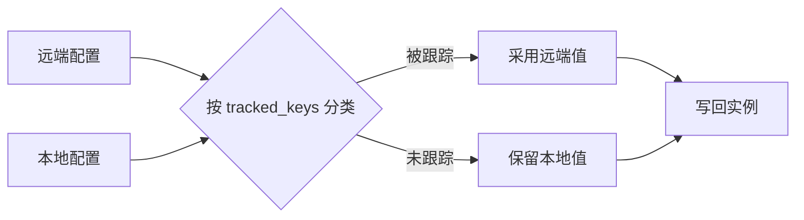

# 配置解析器

配置解析器（parser）负责在同步时**按语义合并配置**，而不是整文件覆盖：服务器下发的键被更新，玩家本地保留的键（如按键、音量、语言）不被改动。

## 一览

| 解析器 | 能力名 | 扩展名 | 合并模式 | 行级跟踪 | 优先级 |
|---|---|---|---|---|---|
| NeoParser_JSON | JSON | `.json` `.json5` `.jsonc` | full_sync / config_merge / no_sync | 否 | 100 |
| NeoParser_YAML | YAML | `.yml` `.yaml` | full_sync / config_merge / no_sync | 否 | 90 |
| NeoParser_TOML | TOML | `.toml` | full_sync / config_merge / no_sync | 否 | 80 |
| NeoParser_SNBT | SNBT | `.snbt` | full_sync / config_merge / no_sync | 否 | 70 |
| NeoParser_Properties | Properties | `.properties` | full_sync / config_merge / no_sync | 否 | 80 |
| NeoParser_TXT | TXT | `.txt` `.properties` `.cfg` | full_sync / line_by_line / no_sync | 是 | 60 |

> 同一扩展名可能匹配多个解析器，按 `priority` 从高到低选择。

> 解析器能力里的 `full_sync`/`config_merge`/`line_by_line`/`no_sync` 是能力声明；`workspace.json` 的策略 `sync_policies.files.<path>.mode` 实际取值为 `full`（整文件覆盖）、`partial`（键/行级合并）、`ignore`（跳过）。

## 契约

所有解析器实现 `NeoCore::IConfigParser`（`modules/NeoCore/include/IConfigParser.h`）：

| 方法 | 作用 |
|---|---|
| `capability()` | 返回 `ParserCapability`（名称/扩展名/模式/行跟踪/优先级） |
| `can_handle(filepath)` | 是否处理该文件 |
| `parse_entries(filepath)` | 解析为 `ConfigEntry` 列表（key_path/remote/local/tracked） |
| `merge_entries(...)` | 按 `tracked_keys` 合并远端与本地内容 |
| `list_keys(filepath)` | 列出可选键（编辑器/策略 UI 使用） |
| `parse_lines` / `merge_lines` | 行级跟踪（仅 TXT 实现） |

工厂导出：

```cpp
extern "C" __declspec(dllexport) NeoCore::IConfigParser* CreateParser();
```

## 加载与目录

- 运行时启动时扫描 `parsers/`（部署目录）；
- 插件 DLL 与同名 `*.meta.json` 必须同时存在；
- 编辑器使用 `editor/extension/parsers/` 下对应的编辑器扩展（`NeoEditorExtension_Parser_*`）。

## 合并语义



- `file_manifest`/策略决定文件是否进入合并；
- `sync_policies.files.<path>.tracked_keys` 指定要同步的键；
- 键路径使用解析器自己的表示（JSON pointer 风格或点号路径，取决于解析器实现）。

## 选择哪种模式

| 场景 | 建议 |
|---|---|
| 服务器配置必须一致 | `full_sync`（整文件覆盖） |
| 玩家个性化与服务器配置共存 | `config_merge` + `tracked_keys` |
| 玩家完全自由 | `no_sync` |
| 逐行差异（文本类） | `partial` + `tracked_lines`（TXT） |

## 新增解析器

1. 实现 `IConfigParser`；
2. 导出 `CreateParser()`（必须 `__declspec(dllexport)`）；
3. 提供 `*.meta.json`（name/version/dll/capability）；
4. 放入 `parsers/`，并更新 [模块参考](../../developer/Modules/_meta.json)。

## 相关

- [JSON](./json.md) · [YAML](./yaml.md) · [TOML](./toml.md) · [SNBT](./snbt.md) · [TXT](./txt.md) · [Properties](./properties.md)
