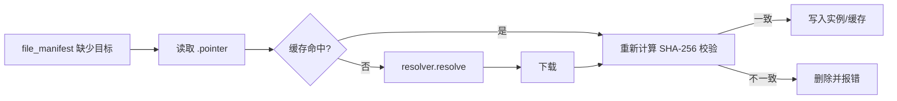

# 指针解析器

指针文件以目标文件的 SHA-256 命名（`branch_config/<sha256>.pointer`），本身只存“如何获取内容”的元数据；**指针解析器（resolver）** 把它解析为真实下载地址。

## 一览

| 解析器 | 能力 | 典型用途 |
|---|---|---|
| NeoPointer_DirectURL | 直链下载 | 任意 HTTPS 直链、CI 产物、镜像 |
| NeoPointer_Modrinth | Modrinth API | 按 `project_id`/`version_id` 获取官方下载地址 |

## 契约

实现 `NeoCore::IPluginPointer`（`modules/NeoCore/include/IPluginPointer.h`）：

| 方法 | 作用 |
|---|---|
| `capability()` | 解析器名称/支持的元数据字段 |
| `resolve(metadata)` | 返回下载 URL（失败返回空并给出错误） |
| `verify(path, sha256)` | 下载后校验（零信任） |

工厂导出：

```cpp
extern "C" __declspec(dllexport) NeoCore::IPluginPointer* CreatePointer();
```

## 指针文件结构

```json
{
  "resolver": "direct_url",
  "metadata": {
    "url": "https://example.com/mods/example-1.2.3.jar"
  },
  "sha256": "<64 hex>",
  "size": 123456
}
```

> 实际文件由 `branch_config/<sha256>.pointer` 保存；路径与哈希的对应关系记录在同分支的 `branch_config/<branch>.json` 的 `file_manifest`。

## 解析与缓存



- 缓存目录：`.minecraft/versions/.cache/<sha256>`（构建侧）与 `.hmcl/nsum/cache/files/<sha256>`（bridge 导入内嵌文件）；
- 每次使用缓存前重新计算 SHA-256（零信任）。

## 加载与目录

- 运行时扫描 `pointers/`；
- 插件 DLL + `*.meta.json` 必须同时存在；
- 编辑器侧对应 `NeoEditorExtension_Pointer_*`。

## 相关

- [DirectURL](./direct-url.md) · [Modrinth](./modrinth.md)
- [指针（作者视角）](../../pack-author/pointers.md)
