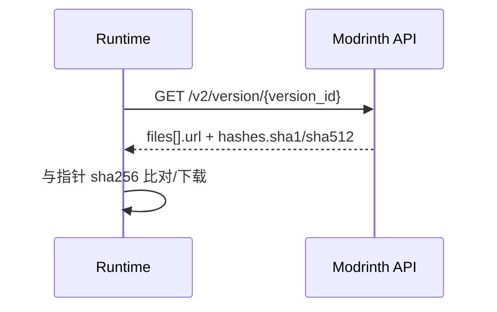

# Modrinth 解析器

`NeoPointer_Modrinth` 通过 Modrinth API 把项目与版本标识解析为官方下载地址，适合公开模组与资源包。

## 能力

| 项 | 值 |
|---|---|
| 解析器名 | `modrinth` |
| 元数据字段 | `project_id`（必填）、`version_id`（可选，推荐固定版本） |
| API | `https://api.modrinth.com/v2` |

## 指针文件

```json
{
  "resolver": "modrinth",
  "metadata": {
    "project_id": "fabric-api",
    "version_id": "0.92.2+1.20.1"
  },
  "sha256": "<64 hex>",
  "size": 123456
}
```

- 指定 `version_id`：解析该版本的首选文件；
- 只给 `project_id`：解析最新版本（不推荐，内容会漂移）。

## 创建

编辑器指针编辑器选择 Modrinth，填写 project/version；CLI：

```powershell
NeoWorkspaceEditor.exe exec pointer-add --path mods/fabric-api.jar --sha256 <64-hex> `
    --resolver modrinth `
    --metadata-json '{"project_id":"fabric-api","version_id":"0.92.2+1.20.1"}' `
    --branch base --repo <仓库>
```

## 解析流程



## 限制

- 需要网络访问 Modrinth API（受限网络下失败会回退为错误，不静默）；
- 模组被作者删除/隐藏后无法解析；
- CurseForge 不支持（需要 API Key，项目不提供）。

## 相关

- [指针解析器总览](./index.md)
- [指针（作者视角）](../../pack-author/pointers.md)
