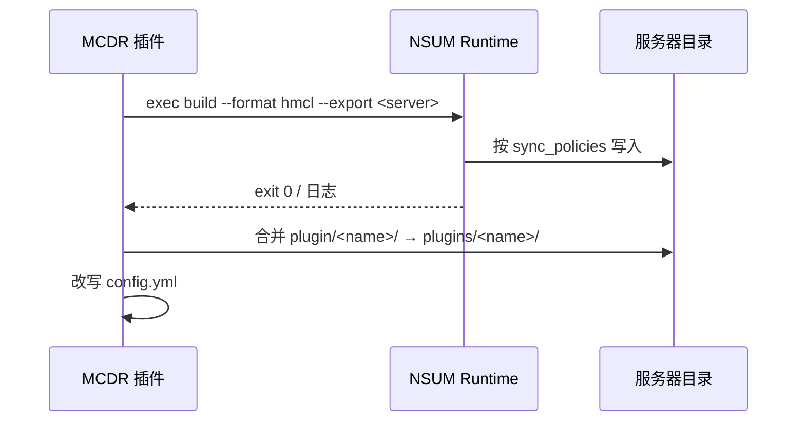

# 服务端同步

## 同步流程



## 命令

插件内部等价调用：

```powershell
NeoServerUpdateModpack.exe exec build --repo <仓库> --modpack server --git-branch main `
    --format hmcl --export <服务器目录>
```

## 插件目录合并

仓库内 `plugin/<name>/` 结构：

```text
plugin/MyPlugin/
├─ plugin.yml
└─ ...
```

同步后合并到 `plugins/MyPlugin/`，并删除中间目录，避免 MCDR 扫描到仓库镜像。

## 保护

- `mirror` 删除前保护服务器运行文件（`logs/`、`world*`、`server.properties` 等，以策略为准）；
- 建议服务端使用 `incremental_add`/`incremental_overwrite`，避免误删存档；
- 同步前停服或使用 `save-off`/`save-all`。

## 失败处理

| 现象 | 原因 | 处理 |
|---|---|---|
| 同步后服务器起不来 | 核心/插件版本不匹配 | 检查日志与核心配置 |
| 插件重复 | 仓库 `plugins/` 与 `plugin/` 同时存在 | 只保留一种布局 |
| 配置被覆盖 | `full` 策略 | 改为 `partial` 保留本地键 |

## 相关

- [配置](./config.md)
- [同步规则](../../pack-author/sync-rules.md)
