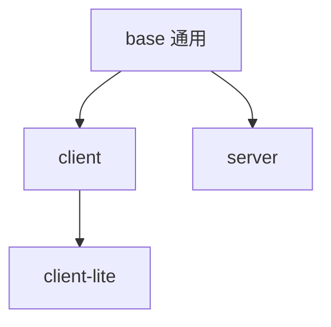

# 最佳实践

## 目录

- `branches/base/` 放通用内容；`client/`、`server/` 只放差异；
- 配置按模组/功能分目录，避免根目录堆文件；
- 大文件（>1 MB）优先指针化；
- `save/` 只用于 serverconfig，不放存档。

## 体积

| 内容 | 做法 |
|---|---|
| mods/*.jar | 指针 + 内容寻址缓存 |
| 资源包/光影 | 指针（或 `custom_mods`） |
| 小配置 | 直接入库 |
| 必须离线可用 | `.nsumpack` 显式内嵌（少量） |

## 分支拆分

- 客户端专用模组只放 `client`；
- 服务端核心与插件只放 `server`；
- 用 `type=client/server` 标记，避免误用。

## 同步策略

| 场景 | 策略 |
|---|---|
| 服务器强制一致 | `mirror` |
| 玩家可加内容 | `incremental_add` |
| 保留玩家设置 | 文件级 `partial` + `tracked_keys` |
| 日志/缓存 | `skip` |

## 提交

- 一次提交只做一件事（加模组/改配置/升级版本分开）；
- 提交前跑 `exec validate` 与 `info preview`；
- 不提交 `build/`、`logs/`、`crash-report/`、`.NSUM/`；
- `.gitignore` 用标记区管理（见 GitIgnoreMarkup）。

## 发布前检查单

- [ ] `workspace.json` 版本/加载器正确；
- [ ] 分支父链无环，`validate` 通过；
- [ ] 大文件已指针化；
- [ ] `info preview` 文件数符合预期；
- [ ] 导出包体积正常（默认 ~1 KB）；
- [ ] 客户端实测导入/同步/启动成功；
- [ ] 服务端分支实测启动成功。

## 相关

- [同步规则](./sync-rules.md)
- [发布](./publish.md)
