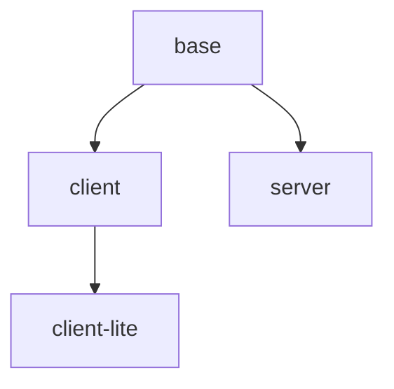

# 仓库结构

NSUM 的数据模型以 Git 仓库为载体：**配置在 `workspace.json`，内容在 `branches/<分支>/`，分支级清单在 `branch_config/<分支>.json`**。

## 顶层布局

```text
<仓库>/
├─ workspace.json              # 工作区与分支定义（唯一事实来源）
├─ branch_config/
│  ├─ <branch>.json            # 分支级：file_manifest / pointer_files /
│  │                           # serverconfig_sync / custom_mods
│  └─ <sha256>.pointer         # 指针文件（内容寻址）
├─ branches/
│  ├─ base/                    # 基础分支内容（客户端/服务端共用）
│  │  ├─ mods/
│  │  ├─ config/
│  │  └─ ...
│  ├─ client/                  # 客户端专用覆盖
│  └─ server/                  # 服务端专用覆盖
└─ .gitignore
```

> 仓库只存“配方”，**不存游戏本体与加载器**；大文件以指针文件引用。

## workspace.json

```json
{
  "version": "1.0",
  "workspace": {
    "name": "My Pack",
    "minecraft": "1.21.1",
    "modloader": "neoforge",
    "modloader_version": "21.1.209"
  },
  "git": {
    "remote": "git@github.com:owner/repo.git",
    "default_branch": "main"
  },
  "branches": [
    { "name": "base", "parent": "", "type": "universal" },
    { "name": "client", "parent": "base", "type": "client" },
    { "name": "server", "parent": "base", "type": "server", "core": "paper" }
  ],
  "sync_policies": {
    "default_folder_policy": "mirror",
    "folders": { "mods": "mirror", "config": "mirror", "logs": "skip" },
    "files": {
      "config/partial.json": { "mode": "partial", "tracked_keys": ["keep"] }
    }
  },
  "export": {
    "metadata": { "name": "My Pack", "version": "1.0.0", "author": "作者" }
  }
}
```

| 字段 | 类型 | 说明 |
|---|---|---|
| `workspace.minecraft` | string | 目标 Minecraft 版本 |
| `workspace.modloader` | string | `fabric`/`quilt`/`forge`/`neoforge` 等 |
| `git.remote` | string | 仓库地址（导出时写入 `.nsumpack`） |
| `git.default_branch` | string | 默认 Git 分支（导出时记录） |
| `branches[].name` | string | 整合包分支名 |
| `branches[].parent` | string/null | 父分支（继承来源） |
| `branches[].type` | string | `universal`/`client`/`server` |
| `branches[].core` | string | 服务端核心（仅 `server`） |
| `branches[].hidden` | bool | 隐藏（不出现在选择列表） |
| `branches[].modloader_version` | string | 分支级加载器版本覆盖 |
| `branches[].description` | string | 描述 |
| `sync_policies` | object | 同步策略（见 [同步规则](./sync-rules.md)） |
| `export.metadata` | object | 导出默认元数据 |

## branch_config/<branch>.json

每个分支一份，四段结构：

```json
{
  "file_manifest": { "mods/example.jar": "<sha256>" },
  "pointer_files": {
    "<sha256>": { "resolver": "direct_url", "metadata": { "url": "https://..." } }
  },
  "serverconfig_sync": { "enabled": false, "scan_paths": [], "rules": [] },
  "custom_mods": { "enabled": false, "path": "", "merge_order": "post" }
}
```

| 段 | 说明 |
|---|---|
| `file_manifest` | 相对路径 → SHA-256（指针文件与缓存索引） |
| `pointer_files` | SHA-256 → 解析器与 metadata |
| `serverconfig_sync` | L3 存档配置同步 |
| `custom_mods` | 外部 mod 目录合并 |

## 分支继承

- 子分支自动继承父分支文件；子分支同名文件覆盖父分支；
- 文件标记（`delete`/`override`）记录在 `BranchManifest`，用于删除或强制覆盖；
- 继承链不允许成环；`NeoWorkspaceEditor.exe exec validate` 会检测。



## 分支类型

| 类型 | 用途 | 限制 |
|---|---|---|
| `universal` | 通用（客户端+服务端） | — |
| `client` | 客户端专用 | 服务端场景不应使用 |
| `server` | 服务端专用 | bridge 拒绝在客户端启动 |

## 完整性

```powershell
NeoWorkspaceEditor.exe exec validate --repo <仓库>
```

- 错误：分支重名、父分支缺失、父链成环；
- 警告：缺少 `branches/<name>/` 或 `branch_config/<name>.json`（本地仓库常见）。
