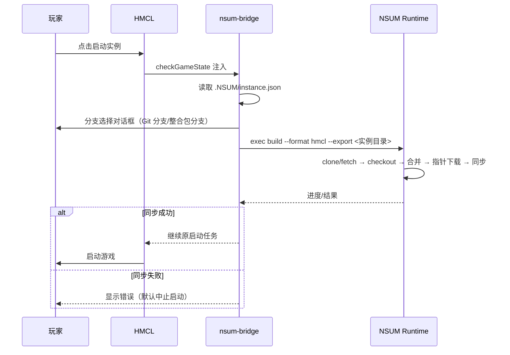

# 同步与启动

NSUM 实例的启动不是直接拉起游戏，而是先在 HMCL 的任务链里插入一次 **Runtime 同步**，成功后才继续原启动流程。

## 启动时序



## 启动注入点

bridge 在 HMCL 的启动检查阶段注入同步任务：

- 通过 Mixin 包装 `LauncherHelper.checkGameState`；
- 任务链：`NSumSyncTask`（NSUM 更新检查）→ 原启动流程；
- 同步任务在 HMCL 任务对话框中显示进度，可取消。

## 分支选择

首次启动/首次同步时出现三步选择（内嵌在任务对话框，不是独立窗口）：

1. Git 分支（`git_branch`）；
2. 整合包分支（`branch`）；
3. 确认。

选择结果写入 `<实例>/.NSUM/instance.json`，后续启动沿用；只读/单候选自动跳过。

## Runtime 同步做了什么

1. 克隆或 fetch 仓库（`.hmcl/nsum/repos/`）；
2. checkout Git 分支并同步到上游；
3. 按整合包分支合并父分支文件；
4. 解析指针文件，缺失文件按 SHA-256 下载并校验；
5. 应用同步策略（`sync_policies`）与文件标记（delete/override）；
6. 写入实例目录（HMCL 格式）。

## 失败策略

| 情况 | 默认行为 |
|---|---|
| 网络失败/下载失败 | 同步失败，启动中止，显示错误 |
| 配置了 `launchOnSyncFailure=true` | 允许带旧内容启动（不推荐） |
| 用户取消任务 | 中止同步与启动 |

失败后可从 `.hmcl/nsum/logs/` 查看最后一份日志。

## MCLHR 集成

同步成功后，bridge 会调用 MCLHR 把 mod store 投影到实例 `mods/`：

```text
java -jar <runtime>/tools/mclhr/mclhr.jar mc mods sync --instance <实例> --mode link --prune
```

- 使用硬链接（跨卷回退复制）；
- 不把 mod 塞进 classpath；
- 重复文件按内容去重。

## FLFHMCL 说明

启动器注入层（FLFHMCL）的行为见其文档。

> **FLFHMCL 文档**：Agent 启动流程、Early Display 与实例选择见 [FLFHMCL 首次启动](https://github.com/HiBer2007/FLFHMCL/blob/docs/bilingual/docs/zh/users/flfhmcl/first-launch.mdx)。

## 相关

- [快速开始](./quick-start.md)
- [故障排查](./troubleshooting.md)
