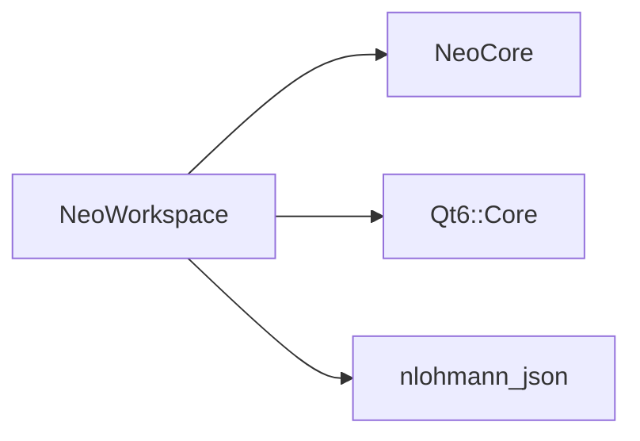

# NeoWorkspace 说明

## 概述

`NeoWorkspace`（STATIC）负责“仓库是什么”：加载 `workspace.json`、维护分支与继承、执行 Git 操作、按策略同步文件、扫描清单与记录历史。

## 设计目标

- 把仓库结构（workspace/branches/branch_config）建模为强类型；
- Git 操作与同步策略可被 CLI/GUI/编辑器复用；
- 所有文件系统操作走 UTF-8 路径。

## 模块边界

**做什么**

- `WorkspaceManager`：加载 `workspace.json`、解析分支/父链/类型/核心；
- `GitOperations`：clone/fetch/checkout/status 等；
- `SyncEngine` / `SyncPolicyExecutor`：按策略应用文件；
- `FileScanner`：扫描与哈希；
- `HistoryStore`：最近仓库历史。

**不做什么**

- 不加载插件（NeoBuild 负责）；
- 不实现导出格式；
- 不直接依赖 Qt GUI。

## 依赖关系

## 文件组成

| 文件 | 作用 |
|---|---|
| `include/workspace_manager.h` | `WorkspaceManager`、`BranchConfig`、`BranchManifest` |
| `include/git_operations.h` | `GitOperations`、`GitResult` |
| `include/sync_engine.h` | `SyncEngine`、`SyncResult` |
| `include/sync_policy.h` | `SyncPolicy`、文件/目录策略 |
| `include/file_scanner.h` | `FileScanner`、`FileEntry`、`DiffResult` |
| `include/history_store.h` | `HistoryStore`、`RecentRepo` |
| `include/repo_urls.h` | `RepoUrl`、多协议地址推导/读写 |
| `include/ssh_key.h` | `SshConfig`、密钥生成/测试/ssh config |
| `src/*.cpp` | 实现 |

## 构建集成

- target：`NeoWorkspace`（STATIC）；
- 依赖：`NeoCore`、Qt6::Core、nlohmann_json；
- 被 NeoBuild/NeoCLI/NeoWorkspaceEditor 依赖。

## 公共符号概览

| 符号 | 类型 | 说明 |
|---|---|---|
| `WorkspaceManager` | class | 工作区/分支 |
| `BranchConfig` | struct | 分支属性 |
| `BranchManifest` | struct | 分支清单 |
| `GitOperations` | class | Git 命令 |
| `SyncEngine` | class | 同步 |
| `FileScanner` | class | 扫描/哈希 |
| `HistoryStore` | class | 历史 |

## 相关

- [usage.md](./usage.md)
- [数据模型](../../architecture/data-model.md)
