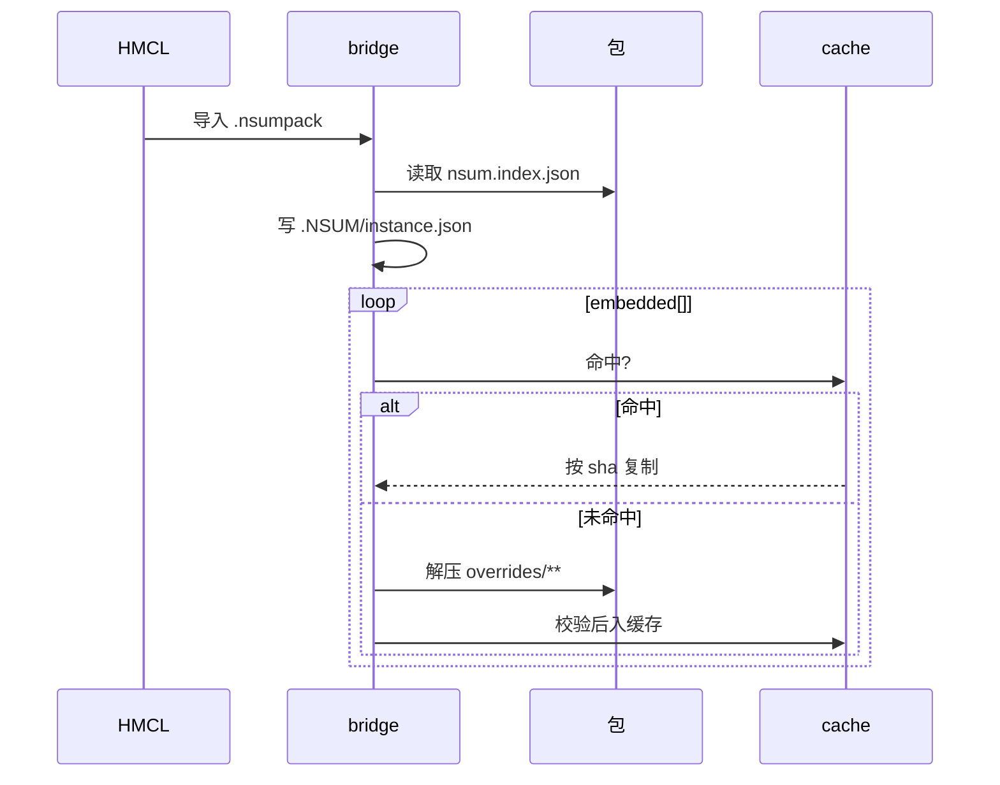

# `.nsumpack` 格式

> **版本**：`pack_format` / `schema` 自 1.0.6 起为 **3**（新增 `repository.urls`）；`pack_format: 2` 的 1.0.5 包继续支持。

`.nsumpack` 是 NSUM 的分发格式：**默认只含清单**，玩家客户端按仓库同步。只有显式声明 `embed_patterns` 才携带文件。

## 结构

```text
<pack>.nsumpack
├─ nsum.index.json      # 清单
└─ overrides/**         # 仅显式内嵌时存在
```

## 最小清单

```json
{
  "pack_format": 3,
  "schema": 3,
  "type": "nsum",
  "name": "My Pack",
  "version": "1.0.0",
  "author": "author",
  "gameVersion": "1.21.1",
  "modloader": "neoforge",
  "modloaderVersion": "21.1.209",
  "repository": {
    "url": "git@github.com:owner/repo.git",
    "urls": [
      { "type": "ssh", "url": "git@github.com:owner/repo.git" },
      { "type": "https", "url": "https://github.com/owner/repo.git" },
      { "type": "http", "url": "http://github.com/owner/repo.git" }
    ],
    "default_branch": "main",
    "branch": "base",
    "git_branch": "main",
    "commit": "<40 hex>"
  },
  "files": [
    { "path": "mods/example.jar", "size": 1234, "sha256": "<64 hex>", "commit": "<40 hex>", "git_branch": "main" }
  ],
  "embedded": [],
  "embed_patterns": [],
  "runtime": { "minVersion": "1.0.0" }
}
```

## 字段

| 字段 | 说明 |
|---|---|
| `pack_format` / `schema` | 文件结构版本（当前 3），与整合包版本无关 |
| `repository.url` | 主仓库地址（旧字段，仍写入；新客户端优先 `urls`） |
| `repository.urls` | 仓库地址列表：`ssh` / `https` / `http` 三种，保序；客户端按顺序回退（自 1.0.6 / pack_format 3） |
| `repository.default_branch` | 默认 Git 分支 |
| `repository.branch` | 整合包分支 |
| `repository.git_branch` / `commit` | 构建所用 Git 分支与提交 |
| `files[]` | 文件索引（只登记，不含字节） |
| `embedded[]` | 实际内嵌的文件（含 `pattern`、sha256、commit、git_branch） |
| `embed_patterns[]` | 本次声明的正则 |
| `runtime.minVersion` | Runtime 最低版本 |

## 内嵌规则

- 正则作用于仓库相对路径，ECMAScript `search`；
- 多个正则换行或 `;` 分隔；
- `save/` 永不内嵌；
- 非法正则导致导出失败。

```powershell
# 只内嵌 config 下的 json
NeoServerUpdateModpack.exe exec build --repo <仓库> --modpack base --git-branch main `
    --format nsum --embed-patterns '^config/.*\.json$' --export out.nsumpack
```

## 导入时序



## 缓存

- 路径：`.hmcl/nsum/cache/files/<sha256>`；
- 跨整合包/实例复用；
- 旧包（无 `embedded`）回退解压全部 `overrides/`。

## 体积实践

| 内容 | 建议 |
|---|---|
| 模组/资源包 | 用指针，不进包 |
| 必须离线可用的配置 | 显式内嵌 |
| 玩家个性化配置 | 不内嵌（由同步策略合并） |

## 相关

- [构建与导出](./build-and-export.md)
- [指针](./pointers.md)
