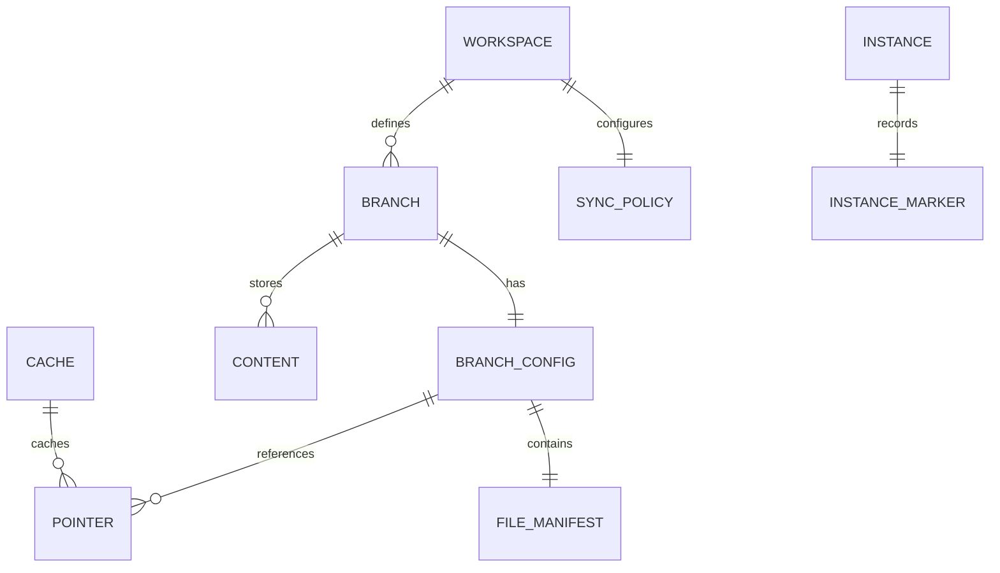
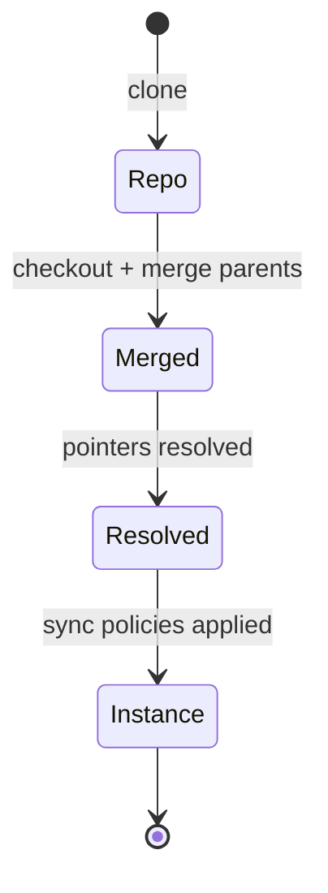

# 数据模型

> **版本**：`workspace.json` 自 1.0.6 起为 `version: 1.1`，新增 `git.remotes[]`；`version: 1.0` 的旧工作区继续兼容。

## 实体关系



## workspace.json

工作区级配置：workspace（mc/modloader）、git（remote/default_branch）、branches[]、sync_policies、export.metadata。

`git.remotes` 记录同一仓库的多种访问地址，按优先级排序；`git.remote` 仍是主地址（旧字段）。运行时按 `--repo-preference` 或默认 `auto` 探测延迟，选择最快地址并保留失败回退顺序（自 1.0.7）。仓库编辑器保存、分支写回时自动补齐三种地址，`exec repo-remotes` 可显式维护：

```json
"git": {
  "remote": "git@github.com:owner/repo.git",
  "remotes": [
    { "type": "ssh",   "url": "git@github.com:owner/repo.git" },
    { "type": "https", "url": "https://github.com/owner/repo.git" },
    { "type": "http",  "url": "http://github.com/owner/repo.git" }
  ],
  "default_branch": "main"
}
```

- `branches[].parent` 形成继承链（禁止环）；
- `branches[].type` 决定客户端/服务端用途；
- `sync_policies` 可被分支级策略覆盖。

## branch_config/<branch>.json

| 段 | 结构 | 作用 |
|---|---|---|
| `file_manifest` | `{relPath: sha256}` | 文件 → 内容哈希 |
| `pointer_files` | `{sha256: {resolver, metadata}}` | 哈希 → 下载方式 |
| `serverconfig_sync` | `{enabled, scan_paths, rules}` | L3 存档配置 |
| `custom_mods` | `{enabled, path, merge_order}` | 外部 mod 目录 |

## 指针

- 文件名：`branch_config/<sha256>.pointer`；
- 内容：resolver + metadata（+ size/sha256）；
- 目标路径由 `file_manifest` 记录（指针本身不含路径）。

## 缓存

```text
.minecraft/versions/.cache/<sha256>        # 构建侧
.hmcl/nsum/cache/files/<sha256>            # bridge 内嵌文件
```

- 键 = 内容 SHA-256；
- 使用前重新计算哈希（零信任）；
- 缓存不随实例删除，可跨实例复用。

## 实例标记

`<实例>/.NSUM/instance.json`：

| 字段 | 说明 |
|---|---|
| `repo` / `branch` / `gitBranch` | 仓库与分支 |
| `packFormat` / `sourceCommit` / `sourceGitBranch` / `defaultBranch` | 来源信息 |
| `branchType` | 客户端/服务端 |
| `launchOnSyncFailure` | 失败是否允许启动 |

## 生命周期



## 一致性规则

- `file_manifest` 的哈希必须与指针/文件内容一致；
- 分支父链必须无环；
- `pointer_files` 中每个哈希都要有对应 `.pointer` 文件（缺失会在构建时报告）；
- 实例标记的 `repo` 必须是用户可见地址，不是本地缓存路径。

## 相关

- [构建流水线](./build-pipeline.md)
- [同步引擎](./sync-engine.md)
