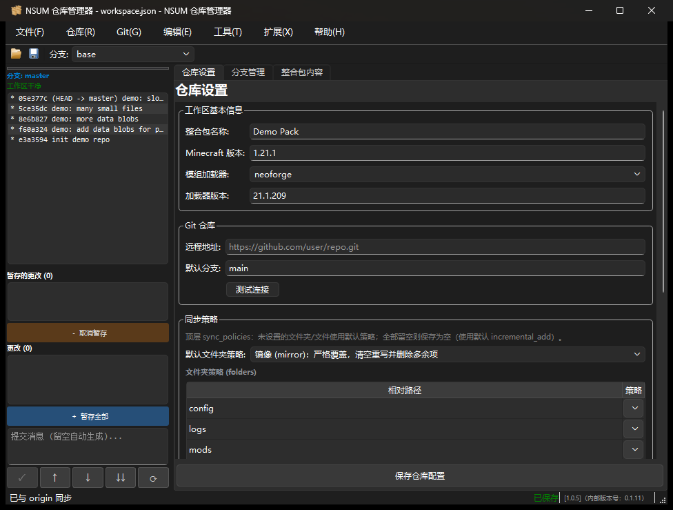
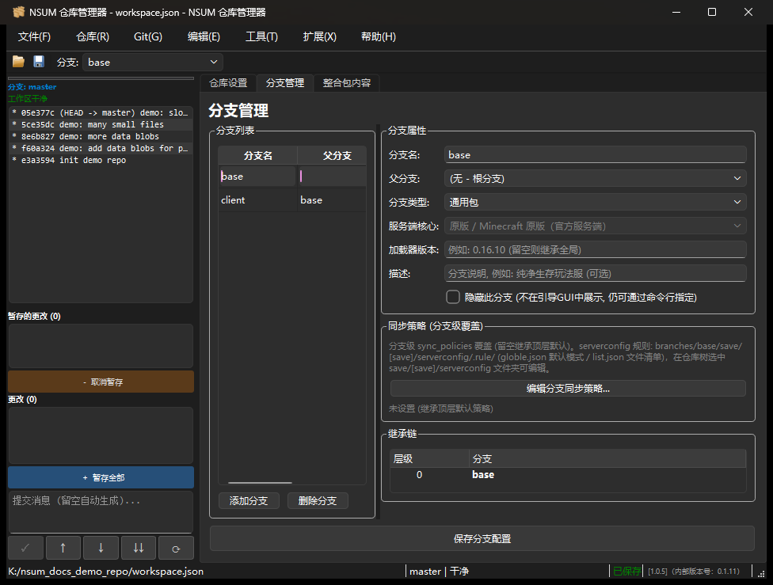
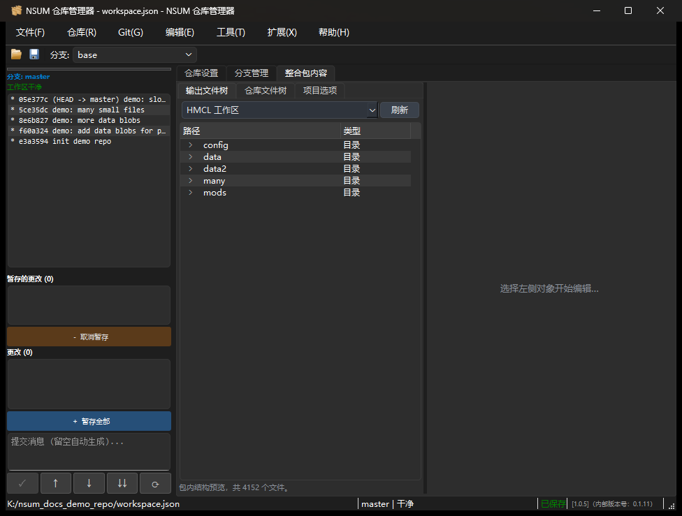

# Editor 界面








`NeoWorkspaceEditor.exe` 是整合包内容 IDE：编辑仓库配置与内容，并把改动落回 Git。

## 打开仓库

```powershell
NeoWorkspaceEditor.exe <仓库目录>
NeoWorkspaceEditor.exe <仓库目录>\workspace.json
```

启动后加载 `workspace.json`，左侧为 Git 面板，右侧三个标签页。

> 自 1.0.6 起支持多仓库地址；旧版 `workspace.json`（`version: 1.0`、仅 `git.remote`）仍可打开，保存后自动升级为 `1.1`。

## 三个标签页

### 1. 仓库设置

- 工作区名称、Minecraft 版本、加载器与版本；
- 仓库地址支持 SSH / HTTPS / HTTP 三个输入框，并选择主地址（`git.remote`，自 1.0.6 起）；
- 主程序（非编辑器）仓库页新增「地址优先级」下拉（自动最快 / 优先 SSH / 优先 HTTPS / 优先 HTTP，自 1.0.7）；克隆失败或 60s 超时自动尝试下一地址；编辑器内仍通过主地址下拉与三个输入框手动指定；
- 保存时写回 `git.remotes[]`（`ssh`/`https`/`http`，主地址排第一），同时把 `version` 升到 `1.1`；
- 默认分支；
- 导出默认元数据（名称/版本/作者/描述）；
- 保存后写回 `workspace.json`。

### 2. 分支管理


- 表格列出所有整合包分支（名称/父分支）；
- 新建、删除、重命名分支；
- 分支属性：类型（通用/客户端/服务端）、服务端核心、加载器版本、描述、隐藏；
- 每个分支的同步策略与 serverconfig/custom_mods 入口；
- 保存时写回 `workspace.json`，并维护 `branch_config/<branch>.json`。

### 3. 整合包内容

双树视图：

| 树 | 内容 |
|---|---|
| 仓库树 | 仓库真实文件（`branches/<branch>/…`） |
| 输出树 | 构建预览（合并后的最终内容） |

- 双击文件：配置类打开 CodeEditor（JSON/YAML/TOML/SNBT/TXT/Properties），其他按类型路由；
- 拖入文件：按落点写入仓库（普通文件/配置/指针转换）；
- 右键：新建、删除、重命名、转换为指针、创建 serverconfig 同步目录等；
- 根节点显示同步策略与分支信息。

## Git 面板

| 操作 | 说明 |
|---|---|
| 刷新 | 异步刷新状态与历史 |
| 暂存/取消暂存 | 单文件或全部 |
| 提交 | 可配置自动暂存；提交信息必填 |
| 拉取/推送/抓取 | 使用内置或系统 Git |
| 撤销/重置 | 谨慎操作，受确认保护 |

提交前建议先运行完整性检查与 `validate`。

## 指针编辑器

- 查看/编辑 `branch_config/<sha>.pointer`；
- 配置 resolver（direct_url / Modrinth）与 metadata；
- 将大文件转换为指针（计算 SHA-256，移动文件到缓存并登记 `file_manifest`）；
- 反向「转回文件」会按 resolver 下载并校验。

## serverconfig 目录

- 右键根节点「创建 serverconfig 同步文件夹」；
- 自动创建 `branches/<branch>/save/[save]/serverconfig/` 与 `.rule` 默认规则；
- 自动 `git add` 该目录，避免空目录丢失。

## 扩展菜单

编辑器加载 `editor/extension/` 下的扩展 DLL：

- 配置解析器扩展（JSON/YAML/TOML/SNBT/TXT/Properties）；
- 指针解析器扩展（Modrinth/DirectURL）；
- 扩展注册表在启动时扫描，菜单/编辑器按扩展动态出现。

## 帮助与文档

- 「帮助 → 帮助文档」打开 `exe/docs` 下的文档（PowerHelper 渲染）；
- 安装器勾选 Editor 时，会释放整合包作者文档（`pack-author`）。

## 常见操作

| 目标 | 操作 |
|---|---|
| 新增客户端分支 | 分支管理 → 新建 → 类型客户端 → 选择父分支 |
| 放入模组 | 整合包内容 → 拖入 `mods/` 或右键导入 |
| 模组转指针 | 右键文件 → 转换为指针 |
| 修改同步策略 | 分支管理/策略编辑器 |
| 提交改动 | Git 面板 → 暂存 → 填写信息 → 提交 |
