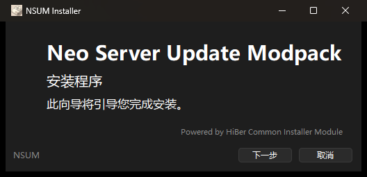

# 安装

> **地址选择（自 1.0.7）**：多地址时默认自动探测最快地址；可在仓库页选择「优先 SSH/HTTPS/HTTP」，或用 `--repo-preference manual` 强制使用输入的 URL。



NSUM 在客户端由三部分组成：**HMCL**（启动器）、**nsum-bridge**（HMCL 扩展）、**NSUM Runtime**（同步引擎）。编辑器（Editor）是可选组件，只有整合包作者需要。

## 方式一：HMCL 里自动安装（推荐）

1. 安装 FLFHMCL 运行时（Fabric 注入层），详见 FLFHMCL 文档。

> **SSH 仓库（自 1.0.6）**：仓库地址为 `git@…` 时，先在主程序「选择仓库源」输入框右侧点击 **SSH 密钥...**（或 `exec git-ssh-key --generate`）生成/选择密钥；程序会自动为内置 Git 设置 `GIT_SSH_COMMAND`。

> **FLFHMCL 文档**：安装步骤、系统要求与 HMCL 版本兼容矩阵见 [FLFHMCL 安装指南](https://github.com/HiBer2007/FLFHMCL/blob/docs/bilingual/docs/zh/users/flfhmcl/install.mdx)。

2. 把 `nsum-bridge-<版本>.jar` 放进 HMCL 工作目录的 `mods/`；
3. 启动 HMCL，左侧出现 **NSUM** 页面；
4. 在 NSUM 页面点「安装 / 更新 Runtime」，bridge 会从 metadata 站点下载最新 Runtime 包并安装到：

```text
<HMCL 工作目录>/.hmcl/nsum/runtime/
```

5. 安装完成后页面会显示 Runtime 版本；若提示「有新版本」，按提示更新即可。

## 方式二：独立安装器

服务器若提供 `NSUM_Installer_<版本>.exe`：

1. 运行安装器，选择安装目录；
2. 按需勾选「编辑器（Editor）」——**勾选后才会释放整合包作者文档**；
3. 安装器会下载内置 Git（MinGit）并写入 `install.conf`，运行时不依赖系统 Git；
4. 安装完成后目录应包含 `NeoServerUpdateModpack.exe`、`deploy/`（或安装目录本身即部署目录）。

## 方式三：便携部署

把 `NSUM_Runtime_<版本>.zip` 解压到任意目录，`NeoServerUpdateModpack.exe` 所在目录即运行时根目录。首次运行可用：

```powershell
.\NeoServerUpdateModpack.exe exec git-update
```

安装/更新内置 Git。

## 校验安装

```powershell
# 查看 Runtime 版本（完整版本形如 1.0.5.0.1.11）
.\NeoServerUpdateModpack.exe info version

# 查看 Git 来源（bundled 表示内置 Git 可用）
.\NeoServerUpdateModpack.exe info git
```

HMCL 侧：

- NSUM 页面能看到 Runtime 版本与「安装 / 更新」按钮；
- 导入 `.nsumpack` 时能识别为 **NSUM 整合包**。

## 目录说明

| 路径 | 内容 |
|---|---|
| `.hmcl/nsum/runtime/` | Runtime 部署目录 |
| `.hmcl/nsum/downloads/` | Runtime 安装包下载缓存 |
| `.hmcl/nsum/repos/` | 克隆/创建的 NSUM 仓库 |
| `.hmcl/nsum/logs/` | bridge 同步日志 |
| `.hmcl/nsum/cache/files/` | 整合包附带文件的 SHA-256 缓存 |

## 卸载

- HMCL 方式：删除 `mods/nsum-bridge-*.jar` 与 `.hmcl/nsum/`（可选保留 `repos/`）；
- 安装器方式：使用系统「应用和功能」或安装器自带卸载流程。

## 常见安装问题

| 现象 | 原因 | 处理 |
|---|---|---|
| NSUM 页面提示 Runtime 未安装 | 只放了 bridge，没装 Runtime | 在 NSUM 页面点「安装 Runtime」 |
| 安装卡在下载 0 B/s | 网络/代理导致大文件下载停滞 | 重试；或手动下载 Runtime 包放入 `.hmcl/nsum/downloads/` 后点「从 downloads 安装」 |
| 提示 SHA-256 校验失败 | 下载不完整或被篡改 | 删除下载文件重试 |
| `git` 不可用 | 内置 Git 未安装且系统无 Git | 运行 `exec git-update`，或检查 `install.conf` |
## FLF 生态仓库

| 项目 | 说明 | 链接 |
|---|---|---|
| FLFHMCL | HMCL 的 Fabric 运行时（Agent + Fabric Loader） | [GitHub](https://github.com/HiBer2007/FLFHMCL) · [文档](https://github.com/HiBer2007/FLFHMCL/blob/docs/bilingual/docs/zh/users/flfhmcl/index.mdx) |
| FLF API | HMCL 的 Fabric API 式扩展层（事件/注册表/UI/账号/下载/整合包接口） | [GitHub](https://github.com/HiBer2007/FLFAPI) · [文档](https://github.com/HiBer2007/FLFAPI/blob/main/docs/zh/index.mdx) |
| FLFHMCLauncher | FLFHMCL 的外壳/高阶入口（环境配置、快速启动、版本隔离、缓存） | [GitHub](https://github.com/HiBer2007/FLFHMCLauncher) |
