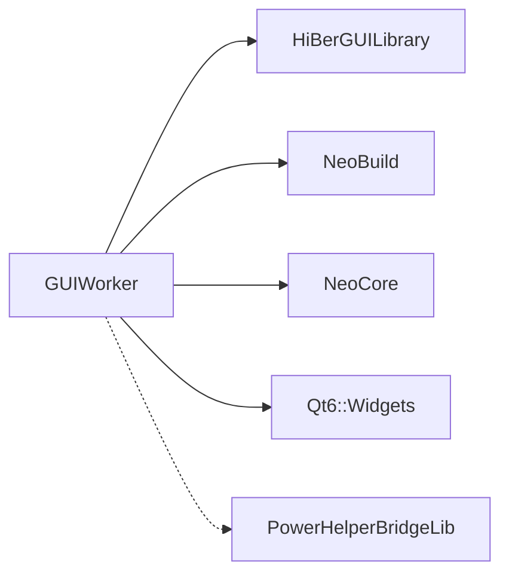

# GUIWorker 说明

## 概述

`GUIWorker`（STATIC，namespace `GUIWorker`）是 GUI 的领域层：包含构建向导各页、构建工具窗口、整合包内容 IDE 面板、指针/策略/serverconfig 编辑器与编辑器扩展注册表。它被主程序与 `NeoWorkspaceEditor` 复用。

## 设计目标

- 把“页面逻辑”与“引擎”分离：页面只收集参数/展示进度；
- 编辑器与主程序共享同一套领域组件；
- 扩展（配置/指针编辑器）通过注册表动态接入。

## 模块边界

**做什么**

- `WizardWindow` 及 8 个页面（repo/branch/modpack/export-type/export-dir/extra/checklist/build/done）；
- `BuildToolWindow`、`BuildPage`、`GuiBuildProgress`；
- `RepoEditor`/`BranchEditor`/`ModpackContentIde`；
- `PointerEditorPanel`、`ConfigFileEditor`、`SyncPoliciesEditor`、`ServerConfigRulesEditor`、`FolderPolicyEditor`、`BatchEditorPanel`；
- `EditorExtensionRegistry` 扫描/注册编辑器扩展。

**不做什么**

- 不做 Git/构建本身（调用 NeoWorkspace/NeoBuild）；
- 不定义插件 ABI（NeoCore）；
- 不含主窗口外壳（主程序/编辑器各自提供）。

## 依赖关系

## 文件组成

| 文件 | 作用 |
|---|---|
| `wizard_window.*` | 向导与流程 |
| `build_page.*` / `build_tool_window.*` | 构建 UI |
| `modpack_content_ide.*` | 内容 IDE |
| `pointer_editor_panel.*` / `pointer_manager.*` | 指针编辑 |
| `config_file_editor.*` | 配置编辑器宿主 |
| `editor_extension_registry.*` | 扩展注册表 |
| 其余 `*_page.*` / `*_editor.*` | 各页面/面板 |

## 构建集成

- target：`GUIWorker`（STATIC）；
- 依赖 HiBerGUILibrary/NeoCore/NeoBuild/Qt6::Widgets（私有 PowerHelperBridgeLib/libzippp/tomlplusplus）；
- 被主程序与 NeoWorkspaceEditor 链接。

## 公共符号概览

| 符号 | 类型 | 说明 |
|---|---|---|
| `WizardWindow` | QWidget | 构建向导 |
| `BuildPage` / `GuiBuildProgress` | QWidget/IBuildProgress | 构建进度 |
| `ModpackContentIde` | QWidget | 内容 IDE |
| `PointerEditorPanel` | QWidget | 指针编辑 |
| `EditorExtensionRegistry` | class | 扩展注册 |
| `CoreInfo` | struct | 核心目录项 |

## 相关

- [usage.md](./usage.md)
- [Editor 界面](../../../pack-author/editor-gui.md)
