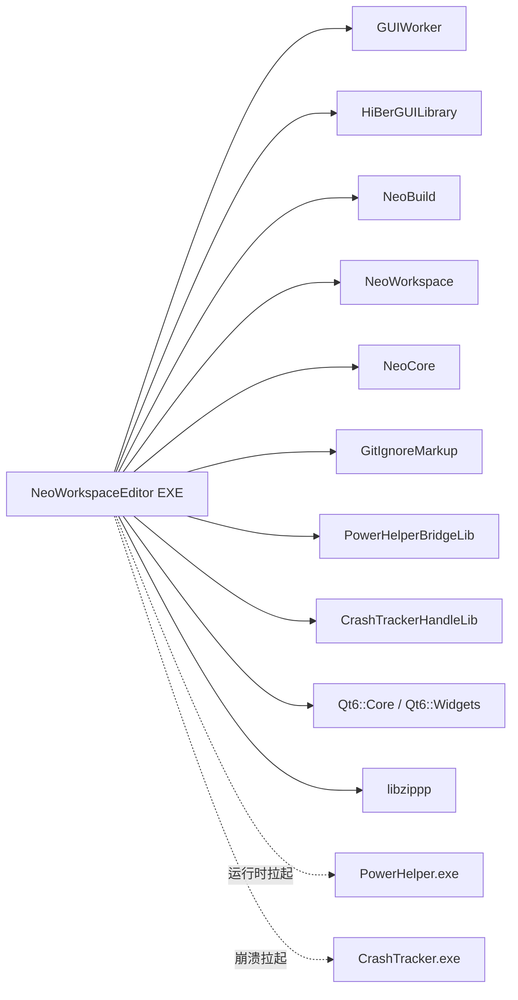

# NeoWorkspaceEditor 说明

## 概述

`NeoWorkspaceEditor`（产物 `NeoWorkspaceEditor.exe`）是 NSUM 的**仓库配置编辑器**：图形界面里编辑 `workspace.json`、分支树、分支内容（`branches/<name>/`）、指针与同步策略，并内置 Git 面板完成暂存/提交/推送。同一个 EXE 还有第二种形态——`info` / `exec` / `help` 三个子命令的**无 GUI CLI**，输出单条 JSON，供 AI 与无人值守脚本操作仓库。

它是「薄壳」：数据模型与页面组件来自 `GUIWorker`（`RepoEditor`/`BranchEditor`/`ModpackContentIde`），领域能力来自 `NeoWorkspace`/`NeoBuild`，组件来自 `HiBerGUILibrary`，帮助文档由 `PowerHelperBridgeLib` 拉起。

## 设计目标

- **GUI 与 CLI 同一份逻辑**：CLI 直接读写 `workspace.json`、`branches/`、`branch_config/`，与 GUI 行为一致；
- **可被自动化**：CLI stdout 只输出一个 JSON 对象（日志走 stderr），退出码 0/1/2 明确；
- **路径安全**：CLI 的一切路径限定在仓库内，拒绝绝对路径与 `..`；
- **启动可视化**：加载期在终端渲染叠层 TUI（拼接字 + 日志滚动 + 进度条），窗口就绪后重放日志；
- **可观测**：崩溃兜底（`CrashTrackerHandleLib`）、日志（`CommonLoggerCPP`，`workspace_editor.log`/`editor`）、堆检查点（Debug）。

## 模块边界

**做什么**

- 打开/新建/克隆仓库（本地、远程缓存、克隆、新建四种来源），保存与另存 `workspace.json`；
- 分支编辑：继承链、类型（`universal`/`client`/`server`）、服务端核心、描述/隐藏、分支属性对话框；
- 内容编辑：仓库树 + 输出树 + 文件内容编辑器（按解析器语法高亮）、指针/自定义模组/服务端配置同步设置；
- Git：状态/历史/暂存/提交/推送/拉取（`GitPanel`，异步）；
- CLI：`info`（workspace/branches/branch/tree/pointers/sync/file/git）与 `exec`（branch-*/file-*/json-*/pointer-*/validate/git-*）；
- 启动时把随包隐藏的 `docs/_editor/<lang>/pack-author` 提升为正式文档树（仅安装了编辑器才发生）。

**不做什么**

- 不做整合包构建与导出（那是主程序 + `NeoBuild` + exporter 插件）；
- 不实现 git 语义（只经 `GitOperation`/`QProcess` 调 git，强推动作有约束）；
- 不在 CLI 里渲染 GUI 页面（CLI 无 `QApplication`，只建 `QCoreApplication`）；
- 不管理客户端实例与同步（bridge 侧职责）。

## 依赖关系

| 依赖 | 类型 | 用途 |
|---|---|---|
| `GitIgnoreMarkup` | STATIC | 「工具 → .gitignore 编辑」对话框 |
| `NeoCore` | STATIC | 插件接口、取消、路径工具、进度 |
| `NeoWorkspace` | STATIC | `WorkspaceManager`/`GitOperations`/同步策略模型 |
| `NeoBuild` | STATIC | 构建产物预览（U/M/D 输出树） |
| `GUIWorker` | STATIC | 领域页面组件（`RepoEditor`/`BranchEditor`/`ModpackContentIde`） |
| `HiBerGUILibrary` | STATIC | 通用组件（树面板、编辑器、Git 面板、进度卡） |
| `PowerHelperBridgeLib` | STATIC | 打开帮助文档 |
| `CrashTrackerHandleLib` | STATIC | 崩溃兜底 |
| `Qt6::Core` / `Qt6::Widgets` | Qt | GUI 与 CLI 的 Qt 基础设施 |
| `libzippp::libzippp` | 第三方库 | 备份导出（zip） |

## 文件组成

| 文件 | 作用 |
|---|---|
| `src/main.cpp` | 入口分流：文档提升 → CLI 判定 → 控制台策略 → TUI 加载层 → `EditorWindow`；崩溃/日志/`install.conf` 的 git 路径注入 |
| `src/editor_cli.h` / `editor_cli.cpp` | 无 GUI CLI：`is_cli_invocation`、`run`，`info`/`exec`/`help` 全部子命令与 JSON 输出 |
| `src/editor_tui.h` / `editor_tui.cpp` | 加载期叠层 TUI（`TuiLogSink` 缓冲日志、拼接字、进度条） |
| `src/editor_window.h` / `editor_window.cpp` | 主窗口：菜单/工具栏/分支选择器/三标签页（仓库设置、分支管理、整合包内容）/Git 面板/加载卡片 |
| `src/branch_meta_dialog.h` / `.cpp` | 分支属性对话框（描述、隐藏等） |
| `src/app.rc` | 资源与版本块（`nsum_add_version_info`） |

## 构建集成

- target：`NeoWorkspaceEditor`，**EXE**（`add_executable(NeoWorkspaceEditor ...)`，**控制台子系统**——GUI 模式经 `holdOrReleaseConsole` 式逻辑保持/释放终端，便于从终端启动时看日志）；
- 链接（PRIVATE）：`GitIgnoreMarkup`、`NeoCore`、`NeoWorkspace`、`NeoBuild`、`GUIWorker`、`HiBerGUILibrary`、`PowerHelperBridgeLib`、`CrashTrackerHandleLib`、`Qt6::Core`、`Qt6::Widgets`、`libzippp::libzippp`；
- 版本资源：`nsum_add_version_info(NeoWorkspaceEditor "NSUM 仓库管理器 - 工作区配置编辑器" "NSUM构建工具")`；
- ASan：`-DNSUM_ASAN=ON` 会给 `NeoCore`/`NeoBuild`/`NeoWorkspace`/`GUIWorker`/`HiBerGUILibrary`/`CrashTrackerHandleLib` 与本 EXE 加 `/fsanitize=address`；
- 部署位置：根 `neo_deploy` 把 `$<TARGET_FILE:NeoWorkspaceEditor>` 复制到 `build/deploy/`，并对 `deploy/NeoWorkspaceEditor.exe` 执行 `windeployqt`（`--no-translations --no-opengl-sw --no-compiler-runtime --no-system-d3d-compiler`）；
- CLI 的 JSON 契约与编辑器 CLI 文档同步维护（仓库另有 `docs/editor-cli.md` 作为早期说明，站点内以本页与 [使用](./usage.md) 为准）。

## 公共符号概览

本 target 是 EXE，无供链接的公共头文件；对外契约是**命令行与 JSON 输出**。

| 符号 | 类型 | 说明 |
|---|---|---|
| `editor_cli::is_cli_invocation` | function | 首个非程序参数是 `info`/`exec`/`help` 时走 CLI |
| `editor_cli::run` | function | 执行 CLI，返回 0/1/2 |
| `EditorWindow` | class（QMainWindow） | `loadWorkspace`/`saveWorkspace`/`saveWorkspaceAs`/`isModified` |
| `RepoSource` | enum class | `Local`/`RemoteCache`/`Clone`/`New` |
| `nsum_tui::EditorTui` | class | 加载期 TUI：`start`/`stop`/`setStatus`/`setProgress` |
| `nsum_tui::TuiLogSink` | class（spdlog sink） | 缓冲日志行供 TUI 重放 |

## 相关文档

- [usage.md](./usage.md)
- [仓库编辑器（GUI）](../../../pack-author/editor-gui.md)
- [编辑器 CLI](../../../pack-author/editor-cli.md)
- [ADR 0008 · 编辑器 CLI](../../adr/0008-editor-cli.md)
